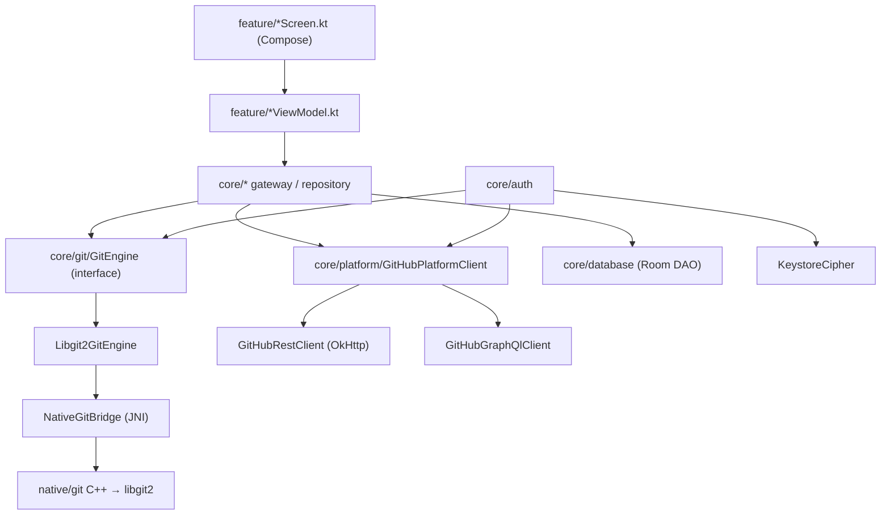
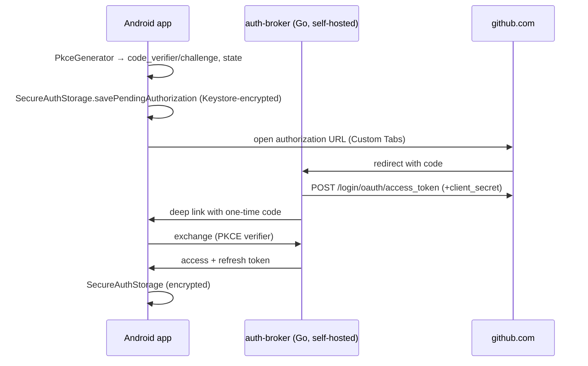

# 03 — Nexora Git Deep Audit

**Repository:** `https://github.com/Gh0stDeveloper/Nexora-Git`
**Audited HEAD:** `f4befb6c1954d956f0a67b14f4ab1642aa185833` (branch `main`, 2026-10-09T03:18:46-06:00)
**License:** Apache-2.0
**Audit date:** 2026-11-19
**Local build executed:** No (no Android SDK/NDK/Gradle/JDK-21 toolchain in the audit environment — see report 16)

---

## 1. What the project is

Nexora Git is a greenfield, single-contributor Android application that combines:

| Layer | Implementation | Files / LOC |
| --- | --- | --- |
| UI | Jetpack Compose + Material 3 | 208 Kotlin files, 46,729 LOC total |
| Presentation | ViewModels + `StateFlow` unidirectional state | `feature/*` = 27,056 LOC |
| Domain/repository | Gateways + `GitEngine` interface | `core/*` = 18,658 LOC |
| Git engine | libgit2 1.9.7 over a hand-written C++17 JNI bridge | `native/git` = 7,058 LOC |
| Syntax engine | Tree-sitter (7 grammars) over JNI | inside `native/git` |
| GitHub platform | OkHttp + REST + GraphQL + ETag cache + rate-limit manager | 20 files in `core/platform` |
| Persistence | Room (3 entities) + DataStore + SAF workspace registry | `core/database`, `core/storage` |
| Background work | WorkManager (`DurableGitWorker`) | `core/work` |
| Auth | GitHub App OAuth + PKCE + device-side encrypted storage + Go broker | `core/auth`, `auth-broker/` |
| Web | Next.js marketing site | `web/` |

The repository is **6 weeks old** (created 2026-10-04) and has delivered its work as ~19
phase-scoped branches merged into `main` in five days. There are **409 commits**, one contributor,
**0 releases**, **0 tags**.

---

## 2. Architecture — documented vs. actual

### 2.1 Documented claim

`docs/ARCHITECTURE.md` states:

> "Nexora Git uses a native Android, feature-modular architecture."
> "Clean Architecture boundaries. Feature-oriented modules. MVVM/MVI-style unidirectional state."

and lists **proposed modules**: `core/api`, `core/auth`, `core/common`, `core/database`,
`core/design-system`, `core/git`, `core/model`, `core/network`, `core/security`, `core/storage`,
`core/testing`.

### 2.2 Actual Gradle graph

`settings.gradle.kts`:

```kotlin
include(":app")
include(":baselineprofile")
```

**Only two Gradle modules exist.** Every `core/*` and `feature/*` package is a directory inside
the single `:app` module. The documented "feature modules" are package conventions, not modules.

> **Finding N-AR-01** — *Documented module decomposition does not exist.*
> Evidence: `settings.gradle.kts` (two includes) vs `docs/ARCHITECTURE.md`.
> Classification: **VERIFIED** (discrepancy confirmed). Risk: **MEDIUM** (architectural drift, not
> a runtime defect). Confidence: High.

### 2.3 Actual layering

Despite the module mismatch, package layering is disciplined:



- `GitEngine` is a 48-function Kotlin interface (`core/git/GitEngine.kt`), with a single
  implementation `Libgit2GitEngine` bound via Hilt (`GitEngineModule.kt`). The interface/impl split
  is real and is the correct seam for an engine swap.
- `GitHubPlatformClient` aggregates REST, GraphQL, pagination and rate limiting.
  Feature gateways (`GitHubRepositoryGateway`, `GitHubAdvancedGitHubGateway`, Actions, Issues,
  Pulls, Releases) consume it — a genuine repository pattern.
- DI is Hilt throughout (`@Singleton`, `@Inject`, `@HiltViewModel`).

**Verdict:** Clean-Architecture *shape* is present; **modularization is not**. This matters for
HMX Git because parallel feature work will collide in one 46k-LOC module and one 100 KB screen
file.

### 2.4 Structural weaknesses (measured)

| File | Size | Problem |
| --- | --- | --- |
| `feature/git/GitWorkspaceScreen.kt` | **100,982 B** | Effectively a god-screen; all git workflows in one file |
| `feature/pulls/PullRequestDetailScreen.kt` | 48,925 B | Review/comment/diff all co-located |
| `feature/advanced/AdvancedGitHubScreen.kt` | 39,549 B | 12+ platform areas in one screen |
| `feature/editor/MobileEditorScreen.kt` | 38,926 B | Editor UI + toolbar + intents |
| `feature/git/GitWorkspaceViewModel.kt` | 38,337 B | ~1,000+ lines, 8 `viewModelScope.launch` entry points |
| `core/advanced/GitHubAdvancedGitHubGateway.kt` | 28,421 B | ~40 REST endpoints in one class |

> **Finding N-AR-02** — *God objects at the presentation layer.*
> Evidence: byte sizes above (`find -printf "%s"`). Risk: **MEDIUM**. Confidence: High.

> **Finding N-AR-03** — *No circular dependencies detected between `core` and `feature`;*
> dependency direction is correct (`feature → core`, never the reverse). Classification:
> **PARTIALLY VERIFIED** (verified by import inspection of representative files, not a full
> dependency-graph tool run). Confidence: Medium.

---

## 3. Build system

| Setting | Value | Source |
| --- | --- | --- |
| Agent | Android Gradle Plugin **9.4.0** | `gradle/libs.versions.toml` |
| Kotlin | **2.2.10** | same |
| Compose BOM | 2026.09.00 | same |
| Gradle wrapper | **9.6.0** (SHA-256 pinned) | `gradle/wrapper/gradle-wrapper.properties` |
| JDK (CI) | **17** | `.github/workflows/android-ci.yml` |
| compileSdk | **37** (SDK 37.0 installed in CI) | `app/build.gradle.kts` |
| targetSdk | **36** | same |
| minSdk | **26** | same |
| NDK | **27.2.12479018** | same |
| CMake | 3.22.1 (native project minimum) | `native/git/CMakeLists.txt` |
| ABIs | `arm64-v8a`, `armeabi-v7a`, `x86_64` | `app/build.gradle.kts` |
| Release minify | `isMinifyEnabled = true`, `isShrinkResources = true` | same |
| applicationId | `com.nexora.git` (`.debug`, `.ci` variants) | same |
| Signing | external `NexoraBuildSecrets`; ephemeral CI signer uses `com.nexora.git.ci` | `app/build.gradle.kts` |
| Baseline profiles | `:baselineprofile` module + `androidx.benchmark` | `settings.gradle.kts` |
| Configuration cache | enabled | `gradle.properties` |
| Native FetchContent | libgit2, Mbed TLS, Tree-sitter + 6 grammars, pinned by 40-char SHA | `native/git/CMakeLists.txt:11-21` |

Native pinning was verified against upstream:

| Pin | Commit | Verified identity |
| --- | --- | --- |
| libgit2 | `49e408b3208bc3093757a1c2db938d3590f3f412` | commit message **"v1.9.7: update version numbers"** (2026-08-13) |
| Mbed TLS | `068ff080b369adfac81509f9b57b2afabaf82dc5` | 2026-07-01 |
| Tree-sitter | `752c612a1359f00e4c113593837a0c1e880214e3` | 2026-10-05 |

> **Finding N-BU-01 (positive)** — Native dependencies are pinned by immutable commit SHA, not by
> mutable branch/tag. **VERIFIED.** Confidence: High.

> **Finding N-BU-02** — Config requires **configuration cache + an external secrets provider**, and
> `nexora.nativeSourceRoot`/`NEXORA_NATIVE_SOURCE_ROOT` for offline builds. A fresh contributor
> cannot build an APK without the GitHub App client ID / broker URL injected through
> `SecureRuntimeConfigNative`. **PARTIALLY VERIFIED** (build script inspected; not executed).
> Risk: **MEDIUM** (onboarding friction). Confidence: Medium.

---

## 4. The real Git engine

### 4.1 Identification

- Engine: **libgit2 1.9.7** (C), pinned.
- Bridge: hand-written **C++17** (`native/git/src/git_jni.cpp`, **50 `JNIEXPORT` functions**)
  matched 1:1 with **50 `external fun`** declarations in `NativeGitBridge.kt`.
- TLS: **Mbed TLS** (pinned). **SSH: disabled** (`USE_SSH OFF` in CMake; no libssh2).
- FS/transport: libgit2's HTTPS transport only, plus a custom LFS transport.

> **Finding N-GE-01** — *JNI surface is exactly symmetric (50 ↔ 50).* **VERIFIED.** Confidence: High.

### 4.2 Operation matrix (Nexora native engine)

Every entry below was traced to the C++ symbol that performs the libgit2 call.

| # | Operation | Implementation | libgit2 call | Async | Progress | Cancel | Tested | Data-loss risk |
| --- | --- | --- | --- | --- | --- | --- | --- | --- |
| 1 | Init | `git_core.cpp` `init_repository` | `git_repository_init` | on `Dispatchers.IO` | n/a | n/a | native smoke | Low |
| 2 | Clone | `git_core.cpp:856` | `git_clone` (`:872`) | IO | **No** | **No** | native `remote_workflow` | Low |
| 3 | Fetch | `git_core.cpp` `fetch` | `git_remote_fetch` (`:1593`) | IO | **No** | **No** | native | Low |
| 4 | Pull | `git_core.cpp:1605` / `pull_with_strategy:1620` | fetch + merge/ff | IO | **No** | **No** | native | Medium (merge path) |
| 5 | Push | `git_core.cpp:2132`; force-with-lease `2197` | `git_remote_push` (`:2177`, `:2328`) | IO | **No** | **No** | native remote_workflow | **Medium** |
| 6 | Commit | `git_core.cpp:1195` | `git_index_write_tree`/`git_commit` | IO | n/a | n/a | native basic_workflow | Low |
| 7 | Status | `git_core.cpp:1031` | `git_status_list_*` | IO | n/a | n/a | native | Low |
| 8 | Stage | `git_core.cpp` stage | `git_index_add_all` | IO | n/a | n/a | native | Low |
| 9 | Unstage | `git_core.cpp` unstage | `git_reset_default` | IO | n/a | n/a | native | Low |
| 10 | Branch create | `advanced_git.cpp` / core | `git_branch_create` | IO | n/a | n/a | native | Low |
| 11 | Checkout | `git_core.cpp` | `git_checkout_tree/head` (`GIT_CHECKOUT_SAFE`) | IO | n/a | n/a | native | Medium (safe mode) |
| 12 | Branch delete | core | `git_branch_delete` | IO | n/a | n/a | native | Low |
| 13 | Merge | `git_core.cpp:2455` (`merge_annotated:451`, `fast_forward:388`) | `git_merge` + index | IO | n/a | n/a | native | **High** if interrupted |
| 14 | Rebase | `git_core.cpp` `git_rebase_init:1779`, `advance_rebase:668`, `advanced_git.cpp rebase_onto:681` | `git_rebase_*` | IO | n/a | **No** | native | **High** |
| 15 | Cherry-pick | `advanced_git.cpp:766` (continue `852`, abort `903`) | `git_cherrypick*` | IO | n/a | n/a | native | Medium |
| 16 | Revert | `advanced_git.cpp:1107` (continue `1193`, abort `1241`) | `git_revert*` | IO | n/a | n/a | native | Medium |
| 17 | Reset | `advanced_git.cpp:1041` | `git_reset` | IO | n/a | n/a | native | **High** (hard reset) |
| 18 | Stash | `advanced_git.cpp:961` save / `929` list / `995` apply / `1029` drop | `git_stash_*` | IO | n/a | n/a | native | Medium |
| 19 | Tags | `advanced_git.cpp:1267` list / `1376` create / `1447` delete | `git_tag_*` | IO | n/a | n/a | native | Low |
| 20 | Remotes | `git_core.cpp` add/rename/remove/lookup | `git_remote_*` | IO | n/a | n/a | native | Low |
| 21 | History/log | core `log`/graph | `git_revwalk` | IO | n/a | n/a | native | Low |
| 22 | Diff | `git_core.cpp:2348` | `git_diff_*` | IO | n/a | n/a | native | Low |
| 23 | Blame | `git_core.cpp:2885` (`git_blame_file:2901`) | `git_blame_file` | IO | n/a | n/a | native | Low |
| 24 | Conflict detection | `git_core.cpp` `repository_has_conflicts:225`, `conflicts_json:233` | index conflicts | IO | n/a | n/a | native | Low |
| 25 | Conflict resolution | `git_core.cpp:2516` `resolve_conflict` — **only `ours`/`theirs`**, no manual text merge | `git_index_conflict_get` + `git_index_add` | IO | n/a | n/a | **untested path** | **High** (silent loss of one side) |

**Important scope limit:** conflict resolution is a binary choice. A user cannot hand-merge a
conflict in Nexora; they must pick a side. Combined with the optional editor, this is the single
biggest functional gap in the Git workflow.

> **Finding N-GE-02** — No transfer-progress callback anywhere in `native/git/src/*.cpp`
> (`grep -i progress` returns only "in-progress" state strings). No `git_remote_callbacks`
> sideband/transfer-progress hook and no `git_transfer_progress_cb`. **VERIFIED (absence).**
> Risk: **HIGH** for UX on large repos; clone/fetch/push appear frozen. Confidence: High.

> **Finding N-GE-03** — No cancellation. `push`/`fetch`/`clone` take no `atomic<bool>`/cancel
> token; the JNI call blocks until libgit2 returns. The Kotlin side cannot cancel a native call.
> **VERIFIED (absence).** Risk: **HIGH** (WorkManager cancellation has no effect mid-transfer).
> Confidence: High.

> **Finding N-GE-04** — No per-repository operation lock. `grep -rn "Mutex|lock_guard|busy|inFlight"`
> across `core/git` and `feature/git` returns no repository-scoped mutex; `GitWorkspaceViewModel`
> launches 8 independent coroutines that can call the native engine concurrently. libgit2 is **not**
> thread-safe for concurrent writes to the same repository. **VERIFIED (absence).** Risk:
> **HIGH** (index/ref corruption under concurrent stage+commit+push). Confidence: High.

> **Finding N-GE-05** — Non-fast-forward is handled via force-with-lease (`push_force_with_lease`)
> and a dedicated status JSON, but the UX path is not device-tested. **PARTIALLY VERIFIED.**
> Confidence: Medium.

### 4.3 Credential callback (security-critical)

`git_core.cpp` `is_github_https_url` (line 127) + `credentials_callback` (line 139):

```cpp
if (!is_github_https_url(url)) {
    return GIT_PASSTHROUGH;
}
```

Only URLs beginning `https://github.com` (exact origin or `https://github.com/...`) receive
credentials. Any other host — GitLab, Codeberg, a self-hosted Gitea, an `http://` URL, a URL with
userinfo or a custom port — is passed through unauthenticated. The Kotlin
`GitRemoteSecurityPolicy` mirrors this. `GitWorkflowPolicy.normalizeGitHubRemoteUrl` even rejects
remote URLs that are not `https://github.com/`.

> **Finding N-GE-06** — *Credential isolation is excellent and vendor scope is hard-coded.*
> **VERIFIED.** Risk: **HIGH** for HMX Git's "any Git host / SSH" requirement; **positive** for
> token-leak prevention. Confidence: High.

### 4.4 JNI safety

`git_jni.cpp` `throw_native` (line 65) maps C++ `GitError` to a typed
`GitNativeException(errorCode, errorClass, message)`; `string_call`/`void_call` wrap every entry
point in `try/catch(...)` and always either return a value or throw. Local references are
`DeleteLocalRef`'d on the error path.

> **Finding N-GE-07** — JNI exception propagation is correct and defensive. **VERIFIED.**
> Risk: INFORMATIONAL. Confidence: High.

---

## 5. Authentication

### 5.1 Flow

Nexora uses a **GitHub App OAuth + PKCE** flow that depends on a **self-hosted Go broker**
(`auth-broker/main.go`, 375 lines) exchanging the code with the GitHub App `client_secret`:



Key files and verified behaviour:

| Concern | Implementation | Evidence |
| --- | --- | --- |
| PKCE | `PkceGenerator.kt` (S256) | VERIFIED (unit test `PkceGeneratorTest`) |
| State binding | `PendingAuthorizationValidator.kt`, `OAuthCallbackParser.kt` | VERIFIED (unit tests) |
| Endpoint policy | `AuthConfig.isValidAuthEndpointPair` + `isValidAppCallbackUri` (strict HTTPS, host/path checks) | VERIFIED |
| Token at rest | `KeystoreCipher.kt` + `SecureAuthStorage.kt` (AES via Android Keystore, encrypted SharedPreferences) | VERIFIED |
| Client secret | Never in APK — held only by broker | VERIFIED (`auth-broker/README.md`, `main.go`) |
| Runtime config | `SecureRuntimeConfigNative` (obfuscated native read of client ID/broker URL) | PARTIALLY VERIFIED (obfuscation script + CI check) |
| Multiple accounts | `AuthAccountEntity` + `AuthSessionRepository.getActiveAccountId()` | VERIFIED (schema + usage) |
| Token refresh | `GitHubRestClient` `401` → refresh → retry once (`:110-125`) | VERIFIED |
| Logout | `AuthSessionRepository` clear + stored-account delete | PARTIALLY VERIFIED |

### 5.2 Consequences for HMX Git

> **Finding N-AU-01** — The auth design requires **the operator to deploy and run a Go service
> with a domain and TLS** before any user can sign in. Issue #57 lists this VPS/domain work as
> **unchecked**. **VERIFIED.** Risk: **HIGH** (operational cost + single point of failure).
> Confidence: High.

> **Finding N-AU-02 (positive)** — Because the client secret lives on the broker and tokens are
> Keystore-encrypted, the APK itself is a clean artifact: `allowBackup=false`,
> `usesCleartextTraffic=false`, strict `network_security_config.xml` (system CAs only; user CAs
> only in `debug-overrides`), and release-artifact secret scanning in CI. **VERIFIED.**
> Confidence: High.

> **Finding N-AU-03** — There is **no Personal Access Token** path and **no SSH key** support.
> A user with only a PAT cannot authenticate to a non-GitHub host at all. **VERIFIED.**
> Risk: **HIGH** for the stated HMX scope.

---

## 6. GitHub platform integration

`core/platform` is the strongest part of the project after the engine.

| Capability | Implementation | Status |
| --- | --- | --- |
| REST client | `GitHubRestClient.kt` (OkHttp 5.5) | VERIFIED |
| Official-host enforcement | `GitHubUrlResolver.requireOfficialApiHost` — only `https://api.github.com` for absolute URLs | VERIFIED |
| GraphQL client | `GitHubGraphQlClient.kt` (285 lines), `GitHubGraphQlOperation` ×10 | VERIFIED |
| Pagination | `GitHubRestPaginator`, `GitHubLinkHeaderParser` | VERIFIED (unit tests) |
| ETag / caching | `If-None-Match` on cached GETs; `GitHubResponseCache`, `GitHubGraphQlCache`, TTL policy | VERIFIED |
| Rate limits | `GitHubRateLimitManager` (headers → `StateFlow`), `/rate_limit` | VERIFIED |
| 401 refresh | single automatic token refresh + retry | VERIFIED |
| Error mapping | `GitHubApiErrorMapper`, `GitHubGraphQlErrorClassifier` | VERIFIED (unit tests) |
| Permission model | `GitHubPermissionResolver`, `GitHubPermissions` | VERIFIED |

### 6.1 API surface actually implemented

| Area | Endpoint family seen in source | Status |
| --- | --- | --- |
| User / identity | `/user`, `/gists` | VERIFIED |
| Repositories | `/repos/{o}/{r}` plus gateway | VERIFIED |
| Branches / files / commits | via repository gateway | PARTIALLY VERIFIED (paths present, parser unit-tested) |
| Issues | `core/issues` gateway + JSON parser | VERIFIED (parser test) |
| Pull requests | `core/pulls` gateway + `PullRequestDetailScreen` | VERIFIED |
| Reviews / comments | in pulls gateway | PARTIALLY VERIFIED |
| Actions / workflow runs | `core/actions` + `/actions/workflows`, `/actions/runs` | VERIFIED |
| Workflow logs | `GitHubActionsLogGateway`: `/actions/jobs/{id}/logs`, `/actions/artifacts/{id}/zip` | VERIFIED |
| Releases / assets | `core/releases` | VERIFIED (parser test) |
| Notifications | `core/social` | VERIFIED |
| Organizations | `core/social` / explore | PARTIALLY VERIFIED |
| Pages | `/repos/.../pages`, `/pages/builds` | VERIFIED (`GitHubAdvancedGitHubGateway`) |
| Security feeds | `/dependabot/alerts`, `/code-scanning/alerts`, `/secret-scanning/alerts` | VERIFIED |
| Codespaces | `/user/codespaces`, `/repos/.../codespaces` | VERIFIED |
| Gists | `/gists`, `/gists/{id}` | VERIFIED |

> **Finding N-GH-01 (positive)** — The GitHub layer is a real, reusable platform abstraction:
> auth-aware, cached, paginated, rate-limit-aware, host-restricted. **VERIFIED.** Confidence: High.

> **Finding N-GH-02** — Retry/backoff beyond the single 401 refresh was not found
> (`grep retry|backoff|429|secondary` in the two clients returns nothing beyond 401). Secondary
> rate-limit (`403` + `Retry-After`) is not handled explicitly. **PARTIALLY VERIFIED (absence).**
> Risk: **MEDIUM**. Confidence: Medium.

> **Finding N-GH-03** — Coverage is broad on paper (≈40 endpoints in one 28 KB gateway). Depth
> (e.g. review submission, threaded comments, workflow re-run) is present as request builders but
> end-to-end behaviour is unproven without a live account. **PARTIALLY VERIFIED.**

---

## 7. Security posture (summary — full report in 07)

| Control | State | Evidence |
| --- | --- | --- |
| `allowBackup` | **false** | `AndroidManifest.xml` |
| Backup rules | all domains excluded | `res/xml/backup_rules.xml`, `data_extraction_rules.xml` |
| Cleartext | **false** | manifest + `network_security_config.xml` |
| Cleartext base config | `cleartextTrafficPermitted="false"`, system trust anchors only | `network_security_config.xml` |
| Token storage | Keystore-encrypted, non-backup | `KeystoreCipher`, `SecureAuthStorage` |
| Deep-link verification | `autoVerify` intent filter + `PendingAuthorizationValidator` | manifest, auth tests |
| Remote host allow-list | `https://github.com` only, userinfo/port rejected | native `is_github_https_url`, `GitRemoteSecurityPolicy` |
| Absolute-URL allow-list | `api.github.com` only | `GitHubUrlResolver` |
| Secret scanning in CI | `scan-android-artifacts-for-secrets.sh` in Production CI | workflow |
| Zip extraction | No zip import implemented (no `ZipInputStream` in source) → **no Zip-Slip surface** | grep |
| WebView | No WebView usage found in app source | grep |
| Logging | No `HttpLoggingInterceptor` wiring to release; `Log.*` usage reviewed | grep |
| Hardcoded secrets | None found; client ID read from native obfuscated config | source inspection |

> **Finding N-SE-01** — The manifest and storage posture is materially better than Gitling's.
> **VERIFIED.** Confidence: High.

> **Finding N-SE-02** — The auth broker is an externally deployed service; its `.env.example`
> holds the client secret. If an operator misconfigures it (plain HTTP, wildcard redirect), the
> security model degrades. **DOCUMENTED ONLY** for deployment correctness (`docs/AUTH_DEPLOYMENT.md`);
> not verifiable in this audit. Risk: **MEDIUM**.

> **Finding N-SE-03** — `SecureRuntimeConfigNative` "obfuscates" the OAuth client ID at the native
> layer (CI validates obfuscation). This is not a security boundary — client IDs are public — and
> is correctly treated as such in docs. Risk: INFORMATIONAL.

---

## 8. Code editor and developer tools (summary — full report in 08)

| Capability | State | Evidence |
| --- | --- | --- |
| Editor UI | Real Compose editor | `feature/editor/MobileEditorScreen.kt` (38,926 B) |
| Buffer / edits | `EditorTextOperations.kt`, `EditorModels.kt` | VERIFIED |
| Undo/redo | `EditorHistory.kt` (custom stack) | VERIFIED (unit test `EditorCoreTest`) |
| Search/replace | implemented in editor VM | PARTIALLY VERIFIED |
| Syntax highlighting | **Tree-sitter** native engine, 7 grammars (Kotlin, Java, JSON, Python, JS, TS, TSX) | `native/git/src/syntax_engine.cpp`; `TreeSitterSyntaxEngine.kt` |
| Symbol/diagnostics extraction | native `Symbol`, `Diagnostic` structs | VERIFIED |
| Multiple tabs | **Not found** | no tab model in editor |
| Autosave | **Not found** | no `autosave`/`snapshotFlow` debounce |
| Crash recovery | **Not found** | editor store writes only on explicit save |
| File-size cap | **512 KiB** hard limit (`EditorFileStore.MAX_EDITOR_BYTES`) | VERIFIED |
| Large-file view cap | 2 MiB before truncation in browser (`CodeBrowserFileSystem.MAX_TEXT_BYTES`) | VERIFIED |
| Markdown preview | renderer present in `CodeBrowserRenderers.kt` | PARTIALLY VERIFIED |
| Formatting | `EditorFormatter.kt` | VERIFIED (unit test) |
| LSP | **Interface only — zero implementations** | `LanguageServerClient.kt`; `grep ": LanguageServerClient"` → none |
| Tree-sitter | Native, real | VERIFIED |
| Terminal | **Not found** | — |

> **Finding N-ED-01** — Nexora is the only audited candidate with a **native Tree-sitter syntax
> engine**. That is a genuine differentiator and directly satisfies an HMX requirement.
> **VERIFIED.** Confidence: High.

> **Finding N-ED-02** — LSP is a **facade**: `LanguageServerClient` declares 7 methods, a
> `LspJsonRpcCodec` builds/parses JSON-RPC, `OptionalLanguageServerRegistry` is an empty
> `@Singleton`, and **no class implements `LanguageServerClient`**. Classification:
> **DOCUMENTED ONLY** — the documentation implies language-server support that does not exist.
> Risk: **MEDIUM** (expectation gap). Confidence: High.

---

## 9. Storage and offline

| Concern | Implementation | Status |
| --- | --- | --- |
| Workspace registry | `core/storage/WorkspaceRegistry.kt`, `WorkspaceEntity` | VERIFIED |
| SAF strategy | `SafPermissionManager`, `SafProjectScanner`, `SafWorkspaceSyncEngine` | VERIFIED |
| Direct filesystem | `DirectProjectScanner`, `WorkspaceStrategyResolver` | VERIFIED |
| Path safety | `WorkspacePathPolicy` (+ unit test) | VERIFIED |
| Gitignore matching | `GitIgnoreMatcher` | VERIFIED |
| Dangerous-project detection | `ProjectRiskDetector` (flags private keys in repos) | VERIFIED |
| Room | 3 entities (`AuthAccount`, `GitHubRepository`, `Workspace`) | VERIFIED |
| Durable operations | `DurableGitWorker` (fetch/pull via WorkManager) | VERIFIED |
| Offline Git | engine is fully local; no network needed for commit/branch/merge | VERIFIED (by design) |
| Interrupted clone | **no resume/cleanup path found** | PARTIALLY VERIFIED (absence) |
| Low-disk handling | **no explicit quota/cleanup found** | UNKNOWN |
| Process-death recovery | WorkManager for fetch/pull only; interactive ops lost | PARTIALLY VERIFIED |

> **Finding N-ST-01** — SAF-based workspace strategy with a real path-policy test is better than
> Gitling's raw `getExternalFilesDir` repositories. **VERIFIED.** Confidence: High.

> **Finding N-ST-02** — Only fetch and pull are wrapped in WorkManager; `clone`, `push`, `merge`,
> `rebase` are foreground coroutines. Process death during a native op leaves libgit2 state
> on disk (a rebase/merge in progress) with no automatic recovery UI beyond an "in progress" note.
> Risk: **MEDIUM**. Confidence: Medium.

---

## 10. UI

- 21 `*Screen.kt` files; Compose + Material 3; single-Activity `NexoraGitApp.kt` with
  `navigation-compose` routes (`home`, `explore`, `repositories`, `git/{workspaceId}`,
  `code/{workspaceId}`, …).
- Bottom navigation for top-level destinations; deep links for OAuth callback.
- 594 strings in `values/strings.xml`; locales: default + `es-rMX` + `night`. i18n is
  near-absent (one extra locale) despite a CI localization guard.
- Accessibility audit document exists (`docs/ACCESSIBILITY_AUDIT.md`) — **DOCUMENTED ONLY**.
- Loading/empty/error states: present via `AppResult` sealed type (`AppResult.Success/Failure`,
  `AppError.*`) — **VERIFIED** at type level, per-screen coverage **PARTIALLY VERIFIED**.

> **Finding N-UI-01** — UI breadth is high (repositories, issues, PRs, Actions, releases, social,
> advanced security, editor, file browser) but each screen is monolithic and largely unverified on
> device. Risk: **MEDIUM** (reuse is plausible but will require refactoring). Confidence: Medium.

---

## 11. CI/CD and testing

18 workflow files exist. Evidence is taken from the GitHub check-runs API per commit, not badges.

| Workflow | Purpose | Evidence |
| --- | --- | --- |
| `android-ci.yml` | Build + lint + unit test + localization guard + config obfuscation check + debug APK | **success** on `b36c868` ("Build, lint and unit test") |
| `native-git-ci.yml` | Build libgit2 core; **ASan+UBSan**; `clang-tidy`; **fuzz** secure decoder; pinned offline build | **success** on `3d0f933` (ASan/UBSan, libgit2 core, fuzz, clang-tidy, pinned-no-network) |
| `production-ci.yml` | Release build + production policy + **secret scan** + size budgets | **success** ("Release build and production gate") on `b36c868` |
| `release.yml` | Tag-triggered signed release with VPS keystore + metadata checks | configured; **never run** (0 tags) |
| `codeql.yml` | Kotlin/Java, C/C++, Go, TS/JS analysis | success on `f4befb6` |
| `dependency-review.yml`, `community-readiness.yml`, `foundation-ci.yml`, `performance.yml`, `fdroid-*`, `web-ci.yml`, `auth-broker-ci.yml`, `vps-installer-ci.yml`, `store-distribution-ci.yml`, `marketing-screenshots.yml`, `render-store-artwork.yml`, `ci-ephemeral-signing.yml` | supporting gates | active |

**Honest caveats:**

- The `main` HEAD `f4befb6` has **CodeQL only** in its check-runs; the Android/native/production
  workflows do not appear on that SHA (they ran on earlier phase commits `b36c868`, `3d0f933`,
  `5ac3f73`). The Android CI path filter (`app/**`, `native/**`, `gradle/**`) excludes the files
  `f4befb6` touched (`scripts/fdroid/**`, `docs/**`), which explains it.
- `Analyze Kotlin/Java` **failed** on `3d0f933` (CodeQL) while all build/test jobs passed.
- Issue #57 still lists "Require all protected `main` CI checks pass after PR #56" as unchecked.

### 11.1 Tests

| Suite | Count | Nature |
| --- | --- | --- |
| Kotlin unit tests (`app/src/test`) | **102 `@Test` methods** across ~30 files | pure-JVM: parsers, PKCE, endpoint policy, editor core, LFS, rate limits, path policy |
| Instrumentation (`app/src/androidTest`) | `FoundationScreenTest`, `MarketingScreenshotTest` | Compose smoke/screenshot |
| Native (`native/git/tests/native_smoke.cpp`) | large assertion suite with `basic_local_workflow` and `remote_workflow` against a **real bare remote** | genuine integration test |

> **Finding N-CI-01 (positive)** — `native_smoke.cpp` exercises clone/push/pull against a
> filesystem bare remote, which is the strongest engine test seen in any candidate.
> **VERIFIED** (source read; CI job success recorded). Confidence: High.

> **Finding N-CI-02** — No test covers the *concurrent operation* scenario, cancellation,
> interrupted transfer, or merge-conflict manual resolution. **VERIFIED (absence).**

> **Finding N-CI-03** — Git engine behaviour is tested natively but **not** through the Kotlin
> `GitEngine` API (no Robolectric/instrumented engine tests). The JNI layer itself is exercised only
> indirectly by C++ tests calling `nexora::git::*`, not JNI signatures.

---

## 12. License

- `LICENSE` = **Apache License 2.0**.
- `NOTICE` = attribution + non-affiliation statement.
- Native deps: libgit2 (`COPYING`: GPL-2.0 **with linking exception**, verified upstream — permits
  linking into non-GPL programs), Mbed TLS (Apache-2.0 OR GPL-2.0), Tree-sitter (MIT), grammars
  (MIT).
- JVM deps: all Apache-2.0/MIT/BSD-style (OkHttp, Retrofit, Hilt, Room, Compose, kotlinx).
- **No copyleft propagation risk** for a proprietary HMX Git.

> **Finding N-LI-01** — Apache-2.0 + libgit2-with-exception is the cleanest base license among the
> candidates. **VERIFIED** (files read). Confidence: High. Full analysis in report 10.

---

## 13. Documentation vs. reality

The docs are extensive (`docs/` has ~30 files) and mostly accurate, but three claims overstate
implementation:

| Claim | Reality | Classification |
| --- | --- | --- |
| "feature-modular architecture" / "proposed modules" | one `:app` module | **DOCUMENTED ONLY** |
| LSP support | interface with no implementation | **DOCUMENTED ONLY** |
| "production" / release readiness | maintainer's own issue says **NO-GO** | contradicted by maintainer |

The last point is notable: rather than overclaiming, the project *self-documents* its NO-GO state.
That is a positive honesty signal even though it confirms immaturity.

---

## 14. Consolidated weakness list

| ID | Weakness | Risk | Evidence class |
| --- | --- | --- | --- |
| W-01 | No SSH transport (`USE_SSH OFF`) | HIGH | VERIFIED |
| W-02 | Credentials restricted to `https://github.com` only; no PAT path | HIGH | VERIFIED |
| W-03 | No transfer progress for clone/fetch/push | HIGH | VERIFIED (absence) |
| W-04 | No cancellation of native operations | HIGH | VERIFIED (absence) |
| W-05 | No repository-scoped operation lock | HIGH | VERIFIED (absence) |
| W-06 | Conflict resolution limited to ours/theirs | HIGH | VERIFIED |
| W-07 | Requires self-hosted auth broker + domain + TLS | HIGH | VERIFIED |
| W-08 | No release, no device QA, self-declared NO-GO | CRITICAL | VERIFIED |
| W-09 | Single contributor, 6-week codebase | HIGH | VERIFIED |
| W-10 | God objects (100 KB screen, 38 KB VM) | MEDIUM | VERIFIED |
| W-11 | LSP facade with no implementation | MEDIUM | VERIFIED |
| W-12 | No editor tabs / autosave / crash recovery | MEDIUM | VERIFIED |
| W-13 | 512 KiB editor cap | LOW | VERIFIED |
| W-14 | No secondary-rate-limit/backoff handling | MEDIUM | PARTIALLY VERIFIED |
| W-15 | i18n exists in CI but only one extra locale | LOW | VERIFIED |
| W-16 | `main` HEAD lacks Android CI evidence | MEDIUM | VERIFIED |
| W-17 | Clone/push not durable across process death | MEDIUM | PARTIALLY VERIFIED |

---

## 15. What Nexora is genuinely good at (reuse candidates for HMX Git)

1. `core/git/GitEngine.kt` + `Libgit2GitEngine.kt` + `native/git/**` — a complete, typed libgit2
   engine covering 25 operations with correct JNI error mapping.
2. `core/platform/**` — a production-shaped GitHub REST/GraphQL client (ETag, pagination,
   rate limits, host allow-list, error mapping).
3. `core/auth/**` — PKCE + Keystore encryption + deep-link validation.
4. `core/editor/**` + `native/git/src/syntax_engine.cpp` — real Tree-sitter syntax intelligence.
5. `docs/`, `.github/workflows/` and `native/git/tests/native_smoke.cpp` — a working quality culture.

## 16. What must be replaced or built before HMX Git could ship

| Area | Action |
| --- | --- |
| Transport | Add SSH (libssh2 or JGit-style) and generic HTTPS/PAT credential provider; relax the GitHub-only allow-list into a per-remote policy |
| Reliability | Single-writer repository lock; transfer-progress callbacks; `git_remote_stop` cancellation; durable clone/push |
| Conflicts | Three-way text editor / manual hunk resolution |
| Auth | Either GitHub Device Flow (drop broker) or an operated broker; multi-host tokens |
| Editor | Tabs, autosave, crash recovery, larger-file streaming |
| Architecture | Split `:app` into real modules; break up the 100 KB screen |
| Release | Device QA matrix, signed release, store readiness |
| LSP | Implement or remove |

---

## 17. Nexora verdict

Nexora Git is **the strongest architectural foundation** of the audited candidates and the only one
that can support HMX Git's full scope under a permissive license. It is **not** a finished product:
the engine lacks SSH, progress, cancellation and locking, and the project has never shipped.

It should be adopted **only behind a Phase-0 verification gate** (reproducible build + device smoke
test), exactly as the final decision in report 17 specifies.
