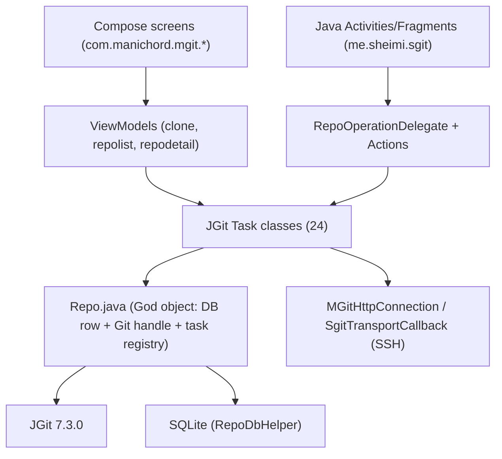

# 04 — Gitling Deep Audit

**Repository:** `https://github.com/maneeshacooray/Gitling`
**Audited HEAD:** `390591428d17e0ddf324ad1dd9ec5f20f45909bc` (branch `master`, tag `v1.0.66`,
2026-11-17T07:41:59+05:30)
**License:** GPL-3.0
**Audit date:** 2026-11-19
**Local build executed:** No (no Android SDK/NDK/Gradle-9.4.1/JDK-21 in the audit environment — see
report 16). The published **v1.0.66 APK was downloaded and inspected**.

---

## 1. What the project is

Gitling is a **fork of MGit, itself a continuation of SGit** (first commit 2013-08-17). The Gradle
root is still named `MGit`; package roots are `me.sheimi.sgit` (SGit) and `com.manichord.mgit`
(MGit). It is a mature, distributed Android Git client built on **JGit 7.3.0**.

| Dimension | Value |
| --- | --- |
| Age | 13 years of lineage; Gitling fork created 2026-03-07 |
| Commits | **1,433** |
| Contributors | **64** (incl. inherited authors) |
| Releases | **68** |
| Latest release | `v1.0.66` (2026-11-17), APK **37,473,461 B** |
| Distribution | Google Play + F-Droid + GitHub Releases |
| Stars / forks | 130 / 8 |
| Open issues | 2 (#118 password-based servers, #56 SSL connection issues) |
| Kotlin | 85 files, 13,835 LOC |
| Java | 75 files, 7,182 LOC |
| Compose screens | 10 `*Screen.kt`, 29 files with `@Composable` |
| Tests | **5** `@Test` methods in 3 files |

Architecture: a hybrid of legacy Java Activities/Fragments plus newer **Compose** screens and a
JGit "task" layer. It is the *opposite* trade-off from Nexora: **proven and shipped, but with a
narrow feature envelope and an aging architecture.**

---

## 2. Build system

| Setting | Value | Source |
| --- | --- | --- |
| AGP | **9.2.0** | `gradle/libs.versions.toml` |
| Kotlin | **2.3.10** | same |
| Gradle wrapper | **9.4.1** | `gradle/wrapper/gradle-wrapper.properties` |
| JDK (CI) | **21** (toolchain) | `.github/workflows/build.yml` |
| compileSdk | **37** | `app/build.gradle.kts:133` |
| targetSdk | **37** | `app/build.gradle.kts:149` |
| minSdk | **23** | `app/build.gradle.kts:148` |
| multiDex | `true` | `app/build.gradle.kts:154` |
| Release minify | **`isMinifyEnabled = false`** | `app/build.gradle.kts:178` |
| `largeHeap` | **`true`** | `AndroidManifest.xml` |
| `allowBackup` | **`true`** | `AndroidManifest.xml` |
| Repositories | `google()`, `mavenCentral()`, **JitPack** (JSch fork) | `settings.gradle.kts` |

### 2.1 The JGit Android 12 compatibility hack (significant)

JGit 6.3+ uses `InputStream.transferTo()` (API 29) and JGit 6.7+ uses `readNBytes`/`readAllBytes`
(API 33). These do not exist on minSdk 23 and are **not** desugared by `desugar_jdk_libs` 2.x.

Gitling solves this with a **build-time ASM bytecode rewrite** (`app/build.gradle.kts`, top comment;
root `build.gradle.kts` adds `org.ow2.asm:asm:9.7` on the buildscript classpath because "AGP's
`AsmClassVisitorFactory` requires the same classloader as AGP itself"):

> Every `INVOKEVIRTUAL` call to `transferTo`/`readNBytes`/`readAllBytes` inside JGit classes is
> rewritten to an `INVOKESTATIC` call into a `StreamCompat` shim that is Java-8-compatible.

The comment documents that this path is reached from `AddCommand.call()` →
`WorkingTreeIterator.getEntryContentLength()` → `possiblyFilteredLength()` → `IO.readWholeStream()`
for staged files ≤ 64 KB, and that it was reproduced live on an API 29 emulator (issue #52).

> **Finding G-BU-01** — *Build-time bytecode patching of a third-party library.*
> **VERIFIED** (source + comments). Risk: **MEDIUM** — clever and documented, but fragile: it
> couples the build to JGit internals and to the exact bytecode shape of every JGit upgrade. This is
> the strongest technical argument against adopting Gitling as a base. Confidence: High.

> **Finding G-BU-02** — `isMinifyEnabled = false` in release, `largeHeap = true`, and a **37.5 MB
> APK with 7 dex files** (measured, report 02 §4). No R8 shrinking means larger download, larger
> install footprint and more resident code than necessary. Risk: **MEDIUM**. Confidence: High.

> **Finding G-BU-03** — `allowBackup = true` with no `dataExtractionRules`/`fullBackupContent`
> exclusion. SecurePreferences ciphertext may be captured in Auto Backup (the Keystore key itself
> does not back up, so the practical risk is limited, but repository files and metadata do back up).
> Risk: **MEDIUM**. Confidence: High.

---

## 3. Architecture

### 3.1 Package map (actual)

```
me.sheimi.sgit            # SGit (legacy Java)
  ├── activities/         # Activities + delegate/actions (24 action classes)
  ├── adapters/           # List adapters
  ├── database/           # RepoDbHelper, RepoDbManager, models/Repo.java (32 KB god object)
  ├── dialogs/ fragments/ preference/
  ├── repo/tasks/repo/    # 24 JGit task classes  ← the engine layer
  ├── ssh/                # JSch credentials, key import/gen
  └── compat/ exception/

com.manichord.mgit        # MGit (newer Kotlin + Compose)
  ├── auth/               # GitHubAuthManager (device flow), AccountManager, RepoCredentials
  ├── branchchooser/ clone/ diff/ documents/ explorer/ importrepo/
  ├── models/ repodetail/ repolist/ settings/ ssh/ tasks/ transport/
  ├── update/ viewfile/ whatsnew/ widget/
  └── MainActivity.kt     # Compose NavHost host
```

### 3.2 Assessment



Problems:

- **`Repo.java` (32,788 B)** is a god object that simultaneously models a database row, owns the
  JGit `Git` handle, caches `StoredConfig`, and holds a `static SparseArray<RepoOpTask>` registry.
  It is the central coupling point of the whole app.
- **Two parallel architectures**: legacy Java Activities with an "Action" delegate pattern, and
  new Compose screens with ViewModels — both active.
- **No DI framework.** `Repo` and `SecurePrefsHelper` are reached through singletons and static
  helpers (`BasicFunctions.getActiveActivity()`).
- SQLite is accessed through a hand-written `SQLiteOpenHelper`/`ContentProvider`, not Room.

> **Finding G-AR-01** — *A 13-year-old god object plus a dual UI architecture is the dominant
> maintainability cost.* **VERIFIED.** Risk: **HIGH** for HMX Git reuse (extending it means editing
> the god object). Confidence: High.

> **Finding G-AR-02** — Layering is nonetheless functional and stable; features ship weekly.
> Risk: INFORMATIONAL.

---

## 4. The Git engine (JGit 7.3.0)

### 4.1 Identification and task layer

24 task classes in `app/src/main/java/me/sheimi/sgit/repo/tasks/repo/`:

`AddToStageTask, CheckoutFileTask, CheckoutTask, CherryPickTask, CloneTask, CommitChangesTask,
CommitDiffTask, DeleteFileFromRepoTask, FetchTask, GetBlameTask, GetCommitGraphTask, GetCommitTask,
InitLocalTask, MergeTask, PullTask, PushTask, RebaseTask, RemoveFromStageTask, RepoRemoteOpTask,
ResetCommitTask, StatusTask, SubmoduleUpdateTask, UnstageAllTask`.

All extend `RepoOpTask` / `RepoRemoteOpTask` (which extend `AsyncTask`).

In addition there is a **command console** — `com.manichord.mgit.repodetail.GitCommandEngine.kt` —
supporting `status`, `log`, `diff`, `branch`, `stash` (list/save/push/pop/drop), `fetch`, `pull`,
`submodule` (status/init/update), `help`. This explains why some features have no dedicated Task
class: stash and tag operations are reachable through the console / JGit API directly.

### 4.2 Operation matrix

| # | Operation | Implementation | Async | Progress | Cancel | Tested | Notes |
| --- | --- | --- | --- | --- | --- | --- | --- |
| 1 | Init | `InitLocalTask` | AsyncTask | n/a | — | No | |
| 2 | Clone | `CloneTask` (+ `RepoCloneMonitor`) | AsyncTask | **Yes** (`ProgressMonitor`) | partial | No | shallow option (`setDepth(1)`) |
| 3 | Fetch | `FetchTask` | AsyncTask | — | partial | No | |
| 4 | Pull | `PullTask` | AsyncTask | — | partial | No | |
| 5 | Push | `PushTask` (push-all, force) | AsyncTask | — | partial | No | **non-FF bug** (see §7) |
| 6 | Commit | `CommitChangesTask` | AsyncTask | n/a | — | No | |
| 7 | Status | `StatusTask` | AsyncTask | n/a | — | No | |
| 8 | Stage | `AddToStageTask` | AsyncTask | n/a | — | No | |
| 9 | Unstage | `RemoveFromStageTask`, `UnstageAllTask` | AsyncTask | n/a | — | No | |
| 10 | Branch create | `NewBranchAction` | AsyncTask | n/a | — | No | |
| 11 | Checkout | `CheckoutTask`, `CheckoutFileTask` | AsyncTask | n/a | — | No | |
| 12 | Branch delete | via JGit (`BranchDeleteCommand`) in UI | AsyncTask | n/a | — | No | |
| 13 | Merge | `MergeTask` | AsyncTask | n/a | — | No | |
| 14 | Rebase | `RebaseTask` | AsyncTask | n/a | — | No | **no continue/abort UI** |
| 15 | Cherry-pick | `CherryPickAction` / `CherryPickTask` | AsyncTask | n/a | — | No | |
| 16 | Revert | **NOT FOUND** as a dedicated task | — | — | — | No | |
| 17 | Reset | `ResetCommitTask` | AsyncTask | n/a | — | No | |
| 18 | Stash | console `GitCommandEngine` (`StashCreate/Apply/Drop`) | AsyncTask | n/a | — | No | no dedicated UI |
| 19 | Tags | via JGit `TagCommand` / branch chooser | AsyncTask | n/a | — | No | |
| 20 | Remotes | `AddRemoteAction`, `RemoveRemoteAction` | AsyncTask | n/a | — | No | |
| 21 | History/graph | `GetCommitGraphTask`, `GetCommitTask` | AsyncTask | n/a | — | No | lazygit-style lane graph in UI |
| 22 | Diff | `CommitDiffTask` | AsyncTask | n/a | — | No | |
| 23 | Blame | `GetBlameTask` | AsyncTask | n/a | — | No | |
| 24 | Conflict detection | JGit `Status` CONFLICTING | AsyncTask | n/a | — | No | |
| 25 | Conflict resolution | file-level "ours/theirs" via checkout; no 3-way merge UI | AsyncTask | — | — | No | |

> **Finding G-GE-01** — *Broad operation coverage via JGit, but with two gaps:* no dedicated
> **Revert** task and no **Rebase continue/abort** recovery UI. Rebase is `rebase().setUpstream().call()`
> only (`RebaseTask.java`); a conflicted rebase leaves the repository mid-operation with no in-app
> continue/skip/abort. Risk: **HIGH** (user can get stuck). Confidence: High.

> **Finding G-GE-02 (positive)** — `CloneTask` installs a real `ProgressMonitor`
> (`RepoCloneMonitor`, `CloneTask.java:114,194`) and publishes clone progress. This is *better* than
> Nexora's clone UX. **VERIFIED.**

> **Finding G-GE-03** — Tasks run on `AsyncTask`. On API 30+ `AsyncTask` is deprecated; the tasks
> hold `Activity` callbacks. Process death or configuration change can drop callbacks. Risk:
> **MEDIUM**. Confidence: High.

> **Finding G-GE-04** — No per-repository locking beyond `Repo`'s `static SparseArray<RepoOpTask>`
> registry (one task per repo), which is a *UI-level* guard, not a transaction lock; the console
> (`GitCommandEngine.execute`) can run concurrently with a task. Risk: **MEDIUM**. Confidence:
> Medium.

### 4.3 Transport

- **HTTPS** via custom `MGitHttpConnection`/`MGitHttpConnectionFactory`, with
  `MGitSSLSocketFactory` (Conscrypt-based; `libconscrypt_jni.so` present in the APK for 4 ABIs).
- **SSH** via **JSch (mwiede 0.2.22)** — genuine: `SgitTransportCallback.java`,
  `SshCredentialsProvider.java`, `AndroidJschCredentialsProvider.java`,
  `PrivateKeyGenerate.kt` (key generation), `PrivateKeyUtils.java` (import/public-key derivation).
- **Multi-host**: credentials resolve per remote host, including self-hosted Forgejo/Gitea
  ("Custom account" in README). This is a **major advantage** over Nexora.
- **Shallow clone**: `CloneTask.SHALLOW_DEPTH = 1`, `setDepth()`, UI checkbox.
- **Git LFS**: **NOT FOUND** (`grep -i lfs` across `app/src/main` returns nothing).
- **Submodules**: `SubmoduleUpdateTask`, `SubmoduleWalk` in `GitCommandEngine`.

> **Finding G-GE-05 (positive)** — SSH with private-key import, export, generation and
> passphrase handling, plus per-host credentials and self-hosted Forgejo/Gitea support.
> **VERIFIED.** This is the capability set HMX Git needs and Nexora lacks. Confidence: High.

> **Finding G-GE-06** — No Git LFS. **VERIFIED (absence).** Risk: **MEDIUM** for HMX scope.

---

## 5. GitHub integration

This is the decisive weakness.

| Capability | State | Evidence |
| --- | --- | --- |
| GitHub sign-in | **OAuth Device Flow** | `auth/GitHubAuthManager.kt` |
| Client ID | hard-coded public OAuth App client ID (`Ov23limX5SJfOQfVzNXZ`) — not a secret, per source comments | `GitHubAuthManager.kt:39` |
| Token storage | `SecurePrefsHelper` (Android Keystore-encrypted SecurePreferences) | `auth/AccountManager.kt` |
| Multiple accounts | `AccountManager` with `global_accounts` JSON + LiveData | VERIFIED |
| Account switching | `RepoCredentials` per repo / account | PARTIALLY VERIFIED |
| Repository browsing | local repos only | — |
| Files (remote) | **NOT FOUND** | — |
| Issues | **NOT FOUND** | — |
| Pull requests | **NOT FOUND** | — |
| Reviews | **NOT FOUND** | — |
| Actions / workflow runs | **NOT FOUND** | — |
| Workflow logs | **NOT FOUND** | — |
| Releases (browsing) | **NOT FOUND** | — |
| Notifications | **NOT FOUND** | — |
| Organizations | **NOT FOUND** | — |
| REST client | none (raw `HttpURLConnection` for the two auth calls only) | — |
| GraphQL | **NOT FOUND** | — |

The **only** `api.github.com` references in the entire source are:

1. `auth/GitHubAuthManager.kt:42` — device-flow token polling (`/login/oauth/access_token`).
2. `update/UpdateChecker.kt:28` — the app's own update check
   (`/repos/maneeshacooray/Gitling/releases/latest`).

> **Finding G-GH-01** — *Gitling has effectively no GitHub platform layer.* It is a Git client with
> GitHub **authentication**, not a GitHub client. **VERIFIED** (exhaustive grep for
> `api.github.com`). Risk: **CRITICAL** relative to HMX Git's GitHub requirements. Confidence: High.

> **Finding G-GH-02** — The device flow is the correct choice for a backend-less APK (no client
> secret). This is a **design HMX Git should copy** regardless of base. **VERIFIED.**

---

## 6. Authentication and security (summary — details in 07)

### 6.1 Strengths

- Device Flow: no `client_secret` in the APK.
- Tokens encrypted through `SecurePreferences` backed by an Android Keystore RSA key pair
  (`SecurePrefsHelper.java`).
- Per-repository/per-host credential resolution.
- SSH host-key handling with keyboard-interactive auth fixes (recent branches
  `fix/ssh-keyboard-interactive-auth`, `fix/ssh-key-import-saf`).
- **Zip-Slip protection** in the repository importer: `RepoImporter.importZip` canonicalises the
  destination and checks each entry against `tempCanonical` (`RepoImporter.kt:170+`). **VERIFIED.**

### 6.2 Material findings

> **Finding G-SE-01 (HIGH)** — `SecurePrefsHelper.java:68`:
> ```java
> Timber.w("pref password %s", prefsPassword);
> ```
> The SecurePreferences **master password is written to logcat**. On a debuggable/rooted device or
> via bug-report capture this defeats the encryption of every stored token/passphrase.
> **VERIFIED.** Risk: **HIGH**. Confidence: High.

> **Finding G-SE-02 (MEDIUM/HIGH)** — `MGitApplication` plants a Timber tree; in release there is no
> evidence of a no-op tree, and `AndroidJschCredentialsProvider.get()` logs
> `Timber.w("need credential for: %s", item.getPromptText())` (prompt contains key **path**). No
> token values are logged, but log metadata leaks. **PARTIALLY VERIFIED.** Confidence: Medium.

> **Finding G-SE-03 (MEDIUM)** — `allowBackup = true` without backup rules (see G-BU-03).

> **Finding G-SE-04 (MEDIUM)** — Deprecated crypto path: `KeyPairGeneratorSpec` +
> `KeyPairGenerator` RSA (`SecurePrefsHelper.java`), an API-18-era approach rather than
> AES/GCM in the Android Keystore. Functional but not modern. Confidence: High.

> **Finding G-SE-05 (LOW)** — `Repo.mPassword` field holds a plaintext password in memory on the
> model object (`Repo.java:68`). Confidence: High.

> **Finding G-SE-06 (positive)** — No hardcoded secrets found. The OAuth client ID is public by
> design. **VERIFIED.**

---

## 7. The non-fast-forward push bug

`PushTask.java` builds a status message in a `switch` over `RemoteRefUpdate.Status`. At line 147:

```java
case REJECTED_NONFASTFORWARD:
    msg = String.format("[%s] Remote ref update was rejected,"
            + " as it would cause non fast-forward update.\n",
            update.getRemoteName());
case REJECTED_OTHER_REASON:
    String reason = update.getMessage();
    ...
```

There is **no `break`** after `REJECTED_NONFASTFORWARD`, so execution **falls through** into
`REJECTED_OTHER_REASON` and the specific non-fast-forward message is **overwritten** (typically
with a null/empty reason, since `update.getMessage()` is usually null for this status).

> **Finding G-GE-07** — *The user is not told that a push was rejected for non-fast-forward.*
> **VERIFIED** (source read). Risk: **MEDIUM** (misleading error, potential confusion leading to
> force-push). Confidence: High.

---

## 8. Code editor and developer tools

| Capability | State | Evidence |
| --- | --- | --- |
| Internal text editor | **None** | `README.md:55`: *"Gitling doesn't include an internal text editor"* |
| File viewer | Read-only **CodeMirror in a WebView** | `ViewFileActivity.kt`, `assets/editor.html`, `assets/js/codemirror-compressed.js` |
| Syntax highlighting (view) | highlight.js / CodeMirror in the WebView | `assets/js/highlight.pack.js` |
| Editing | "Edit" button launches an **external** app via `FsUtils.openFile` | `ViewFileActivity.kt` `onEditClick` |
| Tabs | File/Commits/Blame tabs in the viewer only | `ViewFileScreen.kt` |
| Undo/redo, search/replace | viewer search only | — |
| Tree-sitter | **NOT FOUND** | — |
| LSP | **NOT FOUND** | — |
| Terminal | **NOT FOUND** (there is a *Git command console*, not a shell) | — |
| Markdown preview | possibly via WebView rendering | PARTIALLY VERIFIED |

> **Finding G-ED-01** — *Gitling has no editor.* It is a **file viewer (level 1–2)** in HMX terms,
> not a text editor. Any HMX Git editor would have to be built from scratch. **VERIFIED.**

> **Finding G-ED-02** — The WebView viewer is loaded from `file:///android_asset/editor.html` and
> manipulated through `javascript:` URL injection by `CodeGuesser.wrapUrlScript().setLang(...)`.
> `setJavaScriptEnabled` was not found in the app source (it is implicitly required for this path;
> likely enabled on the WebView instance). Any WebView with JS enabled and file access deserves a
> dedicated review. **PARTIALLY VERIFIED** (settings location not found by grep). Risk: **MEDIUM**.
> Confidence: Medium.

---

## 9. Storage and offline

| Concern | Implementation | Status |
| --- | --- | --- |
| Default repo location | `context.getExternalFilesDir(null)` (`FsUtils.getAppDir`) | VERIFIED |
| Alt media location | `getExternalMediaDirs()` (`FsUtils.getMediaDir`) | VERIFIED |
| Internal dir | `context.getFilesDir()` for SSH keys (`PrivateKeyUtils`) | VERIFIED |
| Database | `SQLiteOpenHelper` + `ContentProvider` (`RepoDbHelper`, `RepoContract`) | VERIFIED |
| Import folder/ZIP | `RepoImporter` with progress + **Zip-Slip guard** | VERIFIED |
| Documents provider | optional "repos as a Files app location" (preview release) | PARTIALLY VERIFIED |
| Offline Git | full JGit local operations | VERIFIED |
| Background work | **No WorkManager** (`grep WorkManager` → none) | VERIFIED (absence) |
| Process-death recovery | tasks are `AsyncTask`; no durable queue | VERIFIED (absence) |
| Storage repair | `BlockedFileRepair` / `FsUtils.findEaccesFile` scoped-storage workarounds | VERIFIED |
| Shallow clone | supported | VERIFIED |

> **Finding G-ST-01** — Repositories live in **app-specific external storage**, which is visible to
> the user via a file manager but is wiped on uninstall. `allowBackup` also captures it. There is no
> SAF-based workspace abstraction. Risk: **MEDIUM** for HMX Git's "credential isolation" and
> "storage strategy" requirements. Confidence: High.

> **Finding G-ST-02** — No WorkManager / no durable background sync; long clone/push only survives
> while the Activity is alive. Risk: **MEDIUM**. Confidence: High.

---

## 10. UI

- Dual UI: legacy Java Activities/Fragments + 10 Compose screens.
- `MainActivity.kt` hosts a Compose `NavHost`.
- Features exposed: repo list, clone (with shallow + progress), branch chooser, commit graph with
  **lazygit-style lanes and inline branch/tag/HEAD labels**, diff, blame, file viewer, settings,
  console tab, submodule screen, "what's new".
- Localization: **12 locale folders** (`ar, de, es, fr, iw, ja, ko, ru, zh-rCN`, plus
  `night`, `sw600dp`, `sw720dp-land`); 277 strings.
- Tablet: `sw600dp`/`sw720dp-land` resources exist → basic tablet support **VERIFIED**.
- Dark mode: `values-night` **VERIFIED**.

> **Finding G-UI-01** — The commit-graph visualisation (lanes + labels) is a genuinely reusable UI
> asset for HMX Git. **VERIFIED** (implementation present; not visually tested here). Confidence:
> Medium.

> **Finding G-UI-02** — No dashboard/social/Actions/Issues/PRs screens because those features do not
> exist. The UI is Git-repository-centric, not GitHub-centric. Risk: **HIGH** for reuse. Confidence:
> High.

---

## 11. CI/CD and testing

### 11.1 Workflows

| Workflow | Trigger | What it does | Evidence |
| --- | --- | --- | --- |
| `build.yml` | push to **`main`** (branch does not exist; default is `master`) + `pull_request` opened/synchronize | `./gradlew --no-daemon clean assembleDebug testDebug` on JDK 21 | 113 runs; latest PR runs success |
| `release.yml` | tag `v[0-9]+.[0-9]+.[0-9]+` | decode keystore, `assembleRelease`, publish APK | ran for `v1.0.66` (**success**) |
| `pages-build-deployment` | Pages | website | dynamic |

> **Finding G-CI-01** — *`build.yml` push trigger is `branches: [main]`, but the default branch is
> `master`.* Direct pushes to `master` therefore do **not** run CI. Pull requests still run (all 10
> most recent runs are `pull_request` and succeeded). **VERIFIED.** Risk: **MEDIUM** (a broken
> commit merged outside a PR — e.g. a merge commit — is not validated; note the v1.0.66 merge commit
> itself shows only the `release` check). Confidence: High.

### 11.2 Tests

| File | `@Test` count |
| --- | --- |
| `app/src/test/java/me/sheimi/sgit/database/models/RepoTest.java` | 2 |
| `app/src/test/java/me/sheimi/sgit/ssh/SshCredentialsProviderTest.java` | 3 |
| `app/src/test/java/me/sheimi/android/utils/CodeGuesserTest.java` | 0 (`@Test` not counted → file present but no annotated tests detected) |
| **Total** | **5** |

`app/src/androidTest` — **does not exist**.

> **Finding G-CI-02** — **Five unit tests for 21,000 LOC and 1,433 commits.** No instrumentation
> tests, no Git-engine integration test against a bare remote, no API tests, no fuzzing, no
> static-analysis gate beyond the Gradle lint that `assembleDebug` may not enforce. **VERIFIED.**
> Risk: **HIGH** (regression risk when extending). Confidence: High.

> **Finding G-CI-03 (positive)** — The **release pipeline is real and works**: `v1.0.66` produced a
> signed APK published to GitHub Releases and distributed to Play/F-Droid. **VERIFIED.** Risk:
> INFORMATIONAL.

---

## 12. License

- Main license: **GPL-3.0** (`LICENSE`, `COPYING`).
- Inherited from SGit/MGit (both GPL-3.0).
- JGit: **EDL-1.0** (Eclipse Distribution License, BSD-style) — compatible to combine *into* a GPL
  work.
- JSch (mwiede): BSD-style.
- Conscrypt: Apache-2.0.
- CodeMirror/highlight.js assets: MIT (bundled JS).

> **Finding G-LI-01** — *Any distributed HMX Git derived from Gitling source must be GPL-3.0.* That
> is a business-model decision, not a technical one. **VERIFIED.** Full analysis in report 10.

---

## 13. Consolidated assessment

### Strengths (reusable ideas / components)

| ID | Strength |
| --- | --- |
| S-01 | Real SSH (JSch) with key import/export/generation and passphrase handling |
| S-02 | Per-host credentials incl. self-hosted Forgejo/Gitea |
| S-03 | Clone progress monitor |
| S-04 | LazyGit-style commit graph with lanes/labels |
| S-05 | Zip-Slip-safe repository importer |
| S-06 | Device Flow auth with no client secret |
| S-07 | Working signed release pipeline + Play/F-Droid distribution |
| S-08 | 13 years of field-hardened edge cases (scoped storage, EACCES repair, shallow clone) |

### Weaknesses

| ID | Weakness | Risk |
| --- | --- | --- |
| W-01 | No GitHub platform layer (issues/PRs/Actions/releases/etc.) | CRITICAL |
| W-02 | No editor (file viewer only) | HIGH |
| W-03 | 5 tests total; no instrumentation/integration tests | HIGH |
| W-04 | `Repo.java` 32 KB god object; dual UI architecture | HIGH |
| W-05 | GPL-3.0 copyleft | HIGH (business) |
| W-06 | Logs SecurePreferences master password | HIGH |
| W-07 | ASM bytecode patching of JGit (fragile) | MEDIUM |
| W-08 | No minify, `largeHeap`, 37.5 MB APK, 7 dex | MEDIUM |
| W-09 | `allowBackup=true` with no exclusions | MEDIUM |
| W-10 | Non-FF push message fall-through bug | MEDIUM |
| W-11 | No rebase continue/abort; no revert task | HIGH |
| W-12 | No WorkManager / durable ops | MEDIUM |
| W-13 | No Git LFS | MEDIUM |
| W-14 | `build.yml` push trigger targets non-existent `main` | MEDIUM |
| W-15 | WebView JS viewer with `javascript:` injection | MEDIUM |

---

## 14. Gitling verdict

Gitling is a **proven, shipped, well-maintained Git client** and the most *trustworthy* code base of
the three. But it solves a different product: **local Git repositories on Android**, with GitHub
used only for sign-in. To turn it into HMX Git you would have to:

1. Build the entire GitHub platform layer (REST + GraphQL, issues, PRs, reviews, Actions, logs,
   releases, notifications, orgs) — roughly the work Nexora already contains.
2. Build an editor with syntax intelligence (Tree-sitter/LSP) — none exists.
3. Fix the god object and dual architecture to make room for both.
4. Accept GPL-3.0.

That is **most of HMX Git's differentiating work**, performed inside a legacy architecture, under a
copyleft license. It is therefore **not** the recommended base (see report 13/17), while remaining a
valuable **reference implementation** for SSH, credentials and release engineering.
