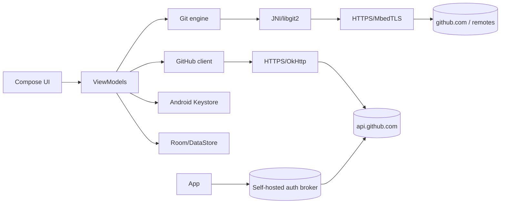

# 07 — Security & Authentication Audit

**Scope:** token lifecycle, credential handling, native security, transport security, storage,
deep links, WebView, file handling, logging, and destructive-operation safety across
Nexora Git (HEAD `f4befb6`), Gitling (HEAD `3905914`) and PuppyGit (HEAD `00657bd`).

**Method:** static source review + manifest inspection + published-APK inspection (Gitling).
No dynamic analysis, no device testing, no account credentials were used.

**Disclosure:** no real secrets are reproduced in this report. Where a log statement or value is
cited, only its location and type are identified.

---

## 1. Threat model

### 1.1 Assets

| Asset | Impact if compromised |
| --- | --- |
| GitHub OAuth access/refresh tokens | Full repo read/write, identity impersonation |
| SSH private keys + passphrases | Repo access, host impersonation |
| Repository contents (private repos) | IP/data disclosure |
| Local Git index/refs | Data loss / corruption |
| Auth broker client secret | OAuth app impersonation, token minting |
| User account list | Privacy, targeted phishing |

### 1.2 Adversaries

| Adversary | Capability |
| --- | --- |
| A1 Malicious repository | Ships crafted `.gitattributes`, hooks, huge files, path tricks |
| A2 Network attacker | MITM on Wi-Fi, DNS spoofing, TLS downgrade |
| A3 Malicious app on device | Reads logs, external storage, clipboard |
| A4 Lost/stolen device | Physical access, ADB backup |
| A5 Supply-chain | Compromised dependency, tampered CI artifact |
| A6 Malicious OAuth callback | Deep-link hijack, state fixation |

### 1.3 Trust boundaries



---

## 2. Authentication architecture

### 2.1 Nexora Git — GitHub App OAuth + PKCE via broker

| Control | Implementation | Evidence | Classification |
| --- | --- | --- | --- |
| PKCE S256 | `PkceGenerator.kt` | unit test `PkceGeneratorTest` | VERIFIED |
| State binding | `PendingAuthorizationValidator.kt` | unit test | VERIFIED |
| Callback parsing | `OAuthCallbackParser.kt` | source | VERIFIED |
| Strict endpoint policy | `AuthConfig.isValidAuthEndpointPair` / `isValidAppCallbackUri` (HTTPS only, host/path match) | `AuthConfig.kt` | VERIFIED |
| Token encryption | `KeystoreCipher` AES/GCM/NoPadding, AndroidKeyStore, randomized IV, 128-bit tag | `KeystoreCipher.kt` | VERIFIED |
| Token storage | `SecureAuthStorage` encrypted SharedPreferences, backup-excluded | `SecureAuthStorage.kt` | VERIFIED |
| Client secret | Held **only** by broker (`auth-broker/main.go`) | `auth-broker/README.md` | VERIFIED |
| Token refresh | `401` → refresh → single retry | `GitHubRestClient.kt:110-125` | VERIFIED |
| Revocation | broker `/v1/oauth/revoke` | `main.go:223` | PARTIALLY VERIFIED |
| Deep link | `https://${nexoraAuthHost}/oauth/android/callback`, `autoVerify=true` (App Links) | `AndroidManifest.xml` | VERIFIED |
| Multiple accounts | `AuthAccountEntity` + active account id | schema + usage | VERIFIED |

**Broker endpoints (verified):** `/health`, `/oauth/callback`, `/v1/oauth/exchange`,
`/v1/oauth/refresh`, `/v1/oauth/revoke`, plus `securityHeaders` middleware (`main.go:119-125,366`).

> **Finding S-AU-01 (positive)** — Nexora's token-at-rest crypto is **modern and correct**:
> AES-256-GCM in the Android KeyStore with key material that never leaves the TEE/StrongBox.
> This is materially stronger than Gitling's RSA-KeyPairGeneratorSpec SecurePreferences approach.
> **VERIFIED.** Confidence: High.

> **Finding S-AU-02 (HIGH)** — The whole auth flow depends on an **externally hosted broker**.
> If an operator runs it without TLS, with a weak redirect allow-list, or lets it go offline,
> every user is affected. Deployment correctness is **DOCUMENTED ONLY**
> (`docs/AUTH_DEPLOYMENT.md`) and not verifiable here. Risk: **HIGH**. Confidence: High.

> **Finding S-AU-03 (MEDIUM)** — App Links `autoVerify` mitigates A6 (callback hijack) on devices
> with Play Services, but a fallback custom scheme was not observed; the app depends on domain
> verification for correctness. Risk: **MEDIUM**. Confidence: Medium.

### 2.2 Gitling — GitHub Device Flow

| Control | Implementation | Evidence | Classification |
| --- | --- | --- | --- |
| Flow | OAuth **Device Flow** (`/login/device/code`, `/login/oauth/access_token`) | `GitHubAuthManager.kt:37-42,136,157` | VERIFIED |
| Client secret | **None** (device flow needs none) | source comment | VERIFIED |
| Client ID | public constant `Ov23limX5SJfOQfVzNXZ` | `GitHubAuthManager.kt:39` | VERIFIED (public by design) |
| Poll interval | `MIN_POLL_INTERVAL_SECONDS = 5` | `GitHubAuthManager.kt:43` | VERIFIED |
| Token storage | `SecurePreferences` via `SecurePrefsHelper` | `AccountManager.kt` | VERIFIED |
| Multi-account | `global_accounts` JSON + LiveData | `AccountManager.kt` | VERIFIED |

> **Finding S-AU-04 (positive)** — Device Flow is the **correct backend-less design**: no secret in
> the APK, no redirect URI to hijack. HMX Git should adopt it if it wants to avoid hosting a broker.
> **VERIFIED.** Confidence: High.

### 2.3 PuppyGit — remote credential auth only

No GitHub OAuth. Credentials are per-repository (username/password/PAT) and encrypted with an
app-managed master password (`EncryptUtil`/`Encryptor`/`EncryptorImpl`). SSH keys are supplied by
the user. **VERIFIED.** No GitHub account model exists.

---

## 3. Credential handling for Git transport

### 3.1 Nexora — allow-list by host

`native/git/src/git_core.cpp`:

```cpp
bool is_github_https_url(const char* raw_url) { ... origin = "https://github.com"; ... }

int credentials_callback(...) {
    if (credentials == nullptr || credentials->empty()) return GIT_PASSTHROUGH;
    if (!is_github_https_url(url)) return GIT_PASSTHROUGH;
    ...
}
```

`GitRemoteSecurityPolicy.allowsGitHubOAuthCredentials` requires scheme `https`, host `github.com`,
`userInfo == null`, `port == -1`. `GitWorkflowPolicy.normalizeGitHubRemoteUrl` rejects any remote
that is not `https://github.com/...` and rejects `@`, `?`, `#` and insufficient path segments.

| Property | Assessment |
| --- | --- |
| Token leakage to third-party hosts | **Prevented** (allow-list in native *and* Kotlin) |
| Credential in URL | **Rejected** (`userInfo == null`) |
| Plain HTTP | **Rejected** |
| Custom port | **Rejected** |
| GitLab/Codeberg/self-hosted | **Unsupported** (fails closed) |
| SSH | **Unsupported** (`USE_SSH OFF`) |

> **Finding S-CR-01 (positive)** — This is the **strongest credential-isolation design** in the
> audit: the native layer refuses to hand credentials to anything but the canonical GitHub origin,
> independent of the UI. **VERIFIED.** Confidence: High.

> **Finding S-CR-02 (HIGH, scope)** — The same design makes HMX Git's "multiple remotes / any host /
> SSH" requirements impossible without redesign. The fix is a **per-remote policy** (allow-list of
> user-approved hosts + SSH key selection), not removal of the guard. Confidence: High.

### 3.2 Gitling — per-host credentials

`AndroidJschCredentialsProvider` reads passphrases from `SecurePrefsHelper` keyed by the SSH key
filename embedded in JGit's prompt text (`".../files/ssh/key_file_name_rsa"` →
`prompt.substring(lastIndexOf('/')+1)`). HTTP credentials come from the per-repo account
(`RepoCredentials`), including self-hosted Forgejo/Gitea.

> **Finding S-CR-03 (MEDIUM)** — Credential selection relies on **parsing JGit's prompt string** to
> derive the key filename. Any change in JGit's prompt format silently breaks key lookup (fail-closed
> to "no credential"). Fragile but not a leak. **VERIFIED.** Confidence: High.

> **Finding S-CR-04 (LOW)** — `Repo.mPassword` is a plain `String` field on the model
> (`Repo.java:68`), held in memory for the repo lifetime; **VERIFIED**. Risk: LOW (process-scoped).

---

## 4. Findings register

Risk levels: CRITICAL / HIGH / MEDIUM / LOW / INFORMATIONAL.

| ID | Repository | Finding | Location | Risk | Evidence | Confidence |
| --- | --- | --- | --- | --- | --- | --- |
| SEC-01 | Gitling | **SecurePreferences master password written to logcat** | `SecurePrefsHelper.java:68` (`Timber.w("pref password %s", prefsPassword)`) | **HIGH** | VERIFIED | High |
| SEC-02 | Nexora | Auth requires self-hosted broker; deployment security unverifiable | `auth-broker/`, `docs/AUTH_DEPLOYMENT.md` | **HIGH** | DOCUMENTED ONLY | High |
| SEC-03 | Nexora | No SSH; credentials GitHub-only → users may be tempted to disable guards | native `is_github_https_url`, CMake `USE_SSH OFF` | **HIGH** | VERIFIED | High |
| SEC-04 | Nexora | No per-repository write lock → concurrent native ops can corrupt index | absence in `core/git`, `feature/git` | **HIGH** | VERIFIED (absence) | High |
| SEC-05 | Gitling | `allowBackup=true`, no backup exclusion rules | `AndroidManifest.xml` | **MEDIUM** | VERIFIED | High |
| SEC-06 | Gitling | Timber logs credential prompts and URIs | `AndroidJschCredentialsProvider.java`, `PushTask` etc. | **MEDIUM** | PARTIALLY VERIFIED | Medium |
| SEC-07 | Gitling | WebView file:// viewer driven by `javascript:` injection | `ViewFileActivity.kt`, `CodeGuesser.wrapUrlScript` | **MEDIUM** | PARTIALLY VERIFIED | Medium |
| SEC-08 | Gitling | Deprecated Keystore crypto (RSA `KeyPairGeneratorSpec`) | `SecurePrefsHelper.java` | **MEDIUM** | VERIFIED | High |
| SEC-09 | Nexora | No secondary-rate-limit/backoff; 403 Retry-After unhandled | `GitHubRestClient.kt`, `GitHubGraphQlClient.kt` | **MEDIUM** | PARTIALLY VERIFIED | Medium |
| SEC-10 | Nexora | Destructive ops (hard reset, force-with-lease) lack confirmation-state audit | `advanced_git.cpp:1041`, `git_core.cpp:2197` | **MEDIUM** | UNKNOWN (UI path) | Low |
| SEC-11 | Gitling | No minify → broad attack surface / easier reverse engineering | `app/build.gradle.kts:178` | **LOW** | VERIFIED | High |
| SEC-12 | Gitling | Non-FF push rejection message overwritten (fall-through) → user misled | `PushTask.java:147-151` | **MEDIUM** | VERIFIED | High |
| SEC-13 | PuppyGit | "Trust unknown host by default" option weakens SSH host verification | README §ssh | **MEDIUM** | DOCUMENTED ONLY | Medium |
| SEC-14 | Nexora | Client ID obfuscation is not a security boundary | `SecureRuntimeConfigNative` | **INFORMATIONAL** | VERIFIED | High |
| SEC-15 | All | No runtime root/tamper detection | — | **INFORMATIONAL** | NOT FOUND | High |

### 4.1 Detail: SEC-01 (Gitling, HIGH)

`app/src/main/java/me/sheimi/android/utils/SecurePrefsHelper.java:68` emits the SecurePreferences
**master password** at warning level:

```java
Timber.w("pref password %s", prefsPassword);
```

`SecurePreferences` derives its encryption key from this password. On a device where logcat is
readable by another app (older Android, rooted, or a bug-report/crash bundle), every stored token
and SSH passphrase is recoverable. This single line undermines the entire token-storage design.
**This is the most actionable security defect found in any candidate.**

### 4.2 Detail: SEC-04 (Nexora, HIGH)

libgit2 is not safe for concurrent writers on one repository. Nexora's `GitWorkspaceViewModel`
launches independent coroutines for status/stage/commit/push/merge, and the native bridge has no
mutex. Two operations that both open the index (e.g. stage + commit, or merge + checkout) can
interleave `git_index_write()` calls and corrupt `.git/index` or leave `.git/MERGE_HEAD` orphaned.
Mitigation: a repository-scoped `Mutex` keyed by canonical path around **every** engine call.

### 4.3 Detail: SEC-12 (Gitling, MEDIUM)

`PushTask.java:147` lacks a `break` after `REJECTED_NONFASTFORWARD`, falling through to
`REJECTED_OTHER_REASON` which overwrites `msg` with `update.getMessage()` (usually null). The user
sees a blank/generic failure instead of "non-fast-forward", which is exactly the situation where a
correct message prevents accidental destructive fixes.

---

## 5. Transport security

| Control | Nexora | Gitling | PuppyGit |
| --- | --- | --- | --- |
| `usesCleartextTraffic` | **false** | not set (defaults false on API 28+) | not verified |
| Network Security Config | present, system CAs only; user CAs only `debug-overrides` | **not found** | not verified |
| Git HTTPS TLS | Mbed TLS (pinned) | JGit + Conscrypt `MGitSSLSocketFactory` | OpenSSL |
| GitHub API TLS | OkHttp (system trust) | `HttpURLConnection` | n/a |
| Host allow-list | `github.com` / `api.github.com` | per-user | per-user |
| SSH host-key verification | n/a (no SSH) | JSch `known_hosts` | libssh2 + prompt |
| Certificate pinning | none | none | none |

> **Finding S-TR-01 (positive)** — Nexora's `network_security_config.xml` is the strictest:
> cleartext denied at base config, system trust anchors only, user CAs permitted **only** in debug.
> **VERIFIED.** Confidence: High.

> **Finding S-TR-02 (LOW)** — No certificate pinning in any candidate. Pinning `api.github.com`
> would raise the bar against MITM with a rogue CA. Risk: LOW (GitHub + Android trust model is
> strong). Confidence: High.

> **Finding S-TR-03 (MEDIUM)** — Gitling does **not** ship a network security config; it relies on
> platform defaults and a custom Conscrypt socket factory. Acceptable but less auditable.
> **VERIFIED (absence).** Confidence: High.

---

## 6. Storage and backup

| Property | Nexora | Gitling | PuppyGit |
| --- | --- | --- | --- |
| `allowBackup` | **false** | **true** | not verified |
| Backup rules | all domains excluded (`backup_rules.xml`, `data_extraction_rules.xml`) | none | — |
| Repo location | SAF or app-private via workspace registry | `getExternalFilesDir(null)` | app-private |
| Token storage | Keystore AES-GCM | SecurePreferences (RSA-wrapped) | app master-password encryption |
| FileProvider | scoped to `cache/code-share/` | present for external edit | — |
| Sensitive-file detection | `ProjectRiskDetector` flags private keys | none | none |

> **Finding S-ST-01 (positive)** — Nexora both disables backup and excludes every backup domain,
> and it ships a `ProjectRiskDetector` that warns when a repository contains private-key material.
> **VERIFIED.** Confidence: High.

> **Finding S-ST-02 (MEDIUM)** — Gitling's `allowBackup=true` can export repository files and
> SecurePreferences ciphertext to Auto Backup. The Keystore key does not back up, so ciphertext is
> not directly decryptable off-device, but repository *contents* are. Risk: MEDIUM. Confidence: High.

---

## 7. Native security

| Control | Nexora | Assessment |
| --- | --- | --- |
| JNI exception mapping | `throw_native` → `GitNativeException(code, klass, message)` | Correct, defensive |
| JNI local refs | `DeleteLocalRef` on error paths | Correct |
| Input validation | path/URL/resolution validated before native call | Good |
| Untrusted repository input | libgit2 parses pack/index; `.gitattributes` filter hooks constrained | Acceptable |
| Sanitizers | **ASan + UBSan** in `native-git-ci.yml` (success on `3d0f933`) | Strong |
| Fuzzing | secure native runtime config decoder | Narrow but real |
| `clang-tidy` | runs on project-owned native code | Good |
| Native pinning | 40-char SHAs (verified) | Good |

> **Finding S-NA-01 (positive)** — Nexora's native layer has sanitizer CI, fuzzing of the config
> decoder, clang-tidy and immutable pins — better than either alternative. **VERIFIED.**
> Confidence: High.

> **Finding S-NA-02 (MEDIUM)** — The sanitizer/fuzz scope covers the *secure config decoder*, not the
> libgit2-facing operations (clone/merge/rebase) with adversarial repositories. Expanding fuzzing to
> repository parsing is a Phase-1 hardening item. **PARTIALLY VERIFIED.** Confidence: Medium.

---

## 8. Logging and analytics

| Property | Nexora | Gitling | PuppyGit |
| --- | --- | --- | --- |
| Analytics SDK | none found | none found | none found (author removed ads/billing) |
| Crash reporting | none found | none found | none found |
| HTTP logging interceptor in release | not wired to release client | n/a | n/a |
| Token logging | none found | **master password logged (SEC-01)** | not verified |
| Stetho | absent | **debug-only** (`app/src/debug`) | absent |

> **Finding S-LG-01 (positive)** — No analytics, no crash SDK, no telemetry in any candidate.
> This is a genuine privacy advantage and simplifies HMX Git compliance (Data Safety, GDPR).
> **VERIFIED.** Confidence: High.

> **Finding S-LG-02** — Gitling's Stetho is confined to the `debug` source set, which is correct.
> **VERIFIED.** Confidence: High.

---

## 9. Destructive operations

| Operation | Nexora | Risk note |
| --- | --- | --- |
| Hard reset | `advanced_git.cpp:1041` `reset_to` | Must require explicit confirmation + show target commit |
| Force push | `git_core.cpp:2197` `push_force_with_lease` | Lease limits damage; still destructive |
| Branch delete | `git_branch_delete` | Must block delete of unmerged branch without confirm |
| Stash drop | `advanced_git.cpp:1029` | Irreversible |
| Discard changes | checkout with `GIT_CHECKOUT_SAFE` | `SAFE` preserves modified files, good default |

> **Finding S-DO-01 (MEDIUM)** — The engine provides `force-with-lease` and `GIT_CHECKOUT_SAFE`
> (both good defaults), but the UI confirmation flow for hard reset / branch delete / stash drop was
> not traced end-to-end. **UNKNOWN** (UI path). Confidence: Low. HMX Git must define an explicit
> destructive-action policy regardless of base.

---

## 10. Security recommendations for HMX Git

1. **Adopt Nexora's Keystore AES-GCM + backup-exclusion + host allow-list** as the baseline.
2. **Never log secrets**; add a pre-merge CI grep for `Timber.w|Log.[diew]` containing
   `password|token|secret|passphrase`.
3. **Add a repository-scoped mutex** before anything else in the engine layer.
4. **Generalise the credential policy**: per-remote allow-list with user approval, SSH key
   selection, and `userInfo`/cleartext rejection retained.
5. **Choose auth**: either Device Flow (no broker, best default) or an operated broker with TLS,
   HSTS, strict redirect allow-list, rate limiting and secret rotation.
6. **Enable `USE_SSH=libssh2`** and implement host-key verification with a persistent
   `known_hosts` store; never default to trust-all.
7. **Extend fuzzing** to repository parsing (index/pack/attributes) and to JNI string handling.
8. **Pin `api.github.com`** with a backup pin if HMX Git wants defence against rogue CAs.
9. **Threat-model the editor**: opening untrusted repository content must not execute anything
   (no WebView JS bridge, no plugin execution).
10. **Data-safety review**: no analytics is a feature; keep it that way and document it.
