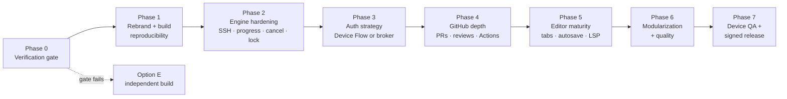

# 14 — HMX Git Adoption & Enhancement Roadmap

**This is a planning document only. No implementation is performed or authorized by this audit.**

**Recommended base:** Nexora Git, Apache-2.0, HEAD `f4befb6c1954d956f0a67b14f4ab1642aa185833`.
**Fallback:** Option E — independent composition on libgit2 + Compose + OkHttp + Room, reusing
Apache-2.0/MIT components and *designs* (not GPL code).

---

## 1. Adoption model

---

## 2. Exact reuse inventory (what to keep)

### 2.1 Git engine — keep

| Path | Why |
| --- | --- |
| `app/src/main/java/com/nexora/git/core/git/GitEngine.kt` | 48-function interface; correct seam |
| `app/src/main/java/com/nexora/git/core/git/Libgit2GitEngine.kt` | single implementation; add lock here |
| `app/src/main/java/com/nexora/git/core/git/NativeGitBridge.kt` | 50 `external fun`, symmetric with JNI |
| `app/src/main/java/com/nexora/git/core/git/GitJsonParser.kt` | native JSON → models |
| `app/src/main/java/com/nexora/git/core/git/GitModels.kt` | DTOs |
| `app/src/main/java/com/nexora/git/core/git/GitNativeException.kt` | typed JNI errors |
| `app/src/main/java/com/nexora/git/core/git/GitRemoteSecurityPolicy.kt` | host policy (to be generalised) |
| `app/src/main/java/com/nexora/git/core/git/GitCredentialProvider.kt` | credential seam |
| `app/src/main/java/com/nexora/git/core/git/GitLfsManager.kt`, `GitLfsTransport.kt` | LFS |
| `native/git/src/git_core.cpp` | 25 core ops, JNI-safe |
| `native/git/src/advanced_git.cpp` | rebase/cherry-pick/revert continue-abort, stash, tags, submodules |
| `native/git/src/git_jni.cpp` | 50 JNI entry points |
| `native/git/src/lfs_filter.cpp` | clean/smudge |
| `native/git/src/syntax_engine.cpp` | Tree-sitter engine |
| `native/git/include/nexora/*.h` | native headers |
| `native/git/CMakeLists.txt` | pinned FetchContent (change SSH flag) |
| `native/git/tests/native_smoke.cpp` | engine integration test — extend, keep |

### 2.2 GitHub platform — keep

| Path | Why |
| --- | --- |
| `core/platform/GitHubRestClient.kt` | ETag, 401 refresh, caching |
| `core/platform/GitHubGraphQlClient.kt` | GraphQL |
| `core/platform/GitHubUrlResolver.kt` | `api.github.com` allow-list |
| `core/platform/GitHubRestPaginator.kt`, `GitHubLinkHeaderParser.kt` | pagination |
| `core/platform/GitHubRateLimitManager.kt`, `GitHubRateLimit.kt` | rate limits |
| `core/platform/GitHubResponseCache.kt`, `GitHubGraphQlCache.kt`, `GitHubCacheCoordinator.kt` | caching |
| `core/platform/GitHubApiErrorMapper.kt`, `GitHubGraphQlErrorClassifier.kt` | errors |
| `core/platform/GitHubPermissionResolver.kt`, `GitHubPermissions.kt` | permissions |
| `core/repository/GitHubRepositoryGateway.kt` | repos/files/commits |
| `core/issues/*`, `core/pulls/*`, `core/releases/*`, `core/actions/*`, `core/social/*`, `core/advanced/*` | feature gateways |

### 2.3 Auth — keep with a decision

| Path | Why |
| --- | --- |
| `core/auth/PkceGenerator.kt`, `GitHubAuthorizationUrlFactory.kt`, `OAuthCallbackParser.kt`, `PendingAuthorizationValidator.kt` | correct PKCE/state |
| `core/auth/KeystoreCipher.kt` | **AES-GCM Keystore** — keep exactly |
| `core/auth/SecureAuthStorage.kt` | encrypted storage |
| `core/auth/AuthSessionRepository.kt`, `AuthModels.kt`, `AuthResult.kt` | session model |
| `auth-broker/` | **optional** — keep only if HMX Git operates it |

### 2.4 Editor — keep

| Path | Why |
| --- | --- |
| `core/editor/EditorTextOperations.kt`, `EditorHistory.kt`, `EditorModels.kt` | buffer/history model |
| `core/editor/EditorFileStore.kt` | atomic save (raise the cap) |
| `core/editor/EditorFormatter.kt` | formatting |
| `core/editor/TreeSitterSyntaxEngine.kt`, `NativeSyntaxBridge.kt`, `SyntaxJsonParser.kt`, `SyntaxModels.kt` | Tree-sitter |
| `feature/editor/MobileEditorScreen.kt`, `MobileEditorViewModel.kt` | UI (needs tabs/autosave) |

### 2.5 Storage / platform — keep

| Path | Why |
| --- | --- |
| `core/storage/*` (workspace registry, SAF strategy, path policy, risk detector, gitignore matcher) | SAF + safety |
| `core/database/*` (Room, 3 entities) | persistence |
| `core/work/DurableGitOperations.kt`, `DurableGitWorker.kt` | durable fetch/pull |
| `core/common/AppResult.kt`, `AppError.kt` | result types |
| `res/xml/network_security_config.xml`, `backup_rules.xml`, `data_extraction_rules.xml` | security posture |
| `AndroidManifest.xml` (minus app id/name) | `allowBackup=false`, cleartext false |

### 2.6 Quality — keep

- `.github/workflows/android-ci.yml`, `native-git-ci.yml`, `production-ci.yml`, `codeql.yml`,
  `dependency-review.yml`, `ci-ephemeral-signing.yml`
- `scripts/ci/*` (localization guard, obfuscation check, secret scan, size budgets)
- `app/src/test/**` (102 tests) and `native/git/tests/native_smoke.cpp`

---

## 3. Required replacements

| # | Component | Current | Replace with | Reason |
| --- | --- | --- | --- | --- |
| R1 | SSH | none (`USE_SSH OFF`) | **libssh2** in CMake + key management UI + `known_hosts` | HMX requires SSH |
| R2 | Credential policy | `https://github.com` only | per-remote allow-list + PAT + SSH key selection | HMX requires multi-host |
| R3 | Auth broker | self-hosted Go service | **GitHub Device Flow** (default) or operated broker | Remove deployment blocker |
| R4 | Progress | none | `git_transfer_progress_cb` → UI | UX on large repos |
| R5 | Cancellation | none | `git_remote_stop` + coroutine cancel | UX + WorkManager correctness |
| R6 | Repo lock | none | `Mutex` keyed by canonical path around every engine call | Prevent corruption |
| R7 | Conflict resolution | ours/theirs | 3-way / hunk merge UI | Required feature |
| R8 | Editor tabs/autosave | none | `OpenDocument` model + debounced atomic save + recovery journal | Required feature |
| R9 | LSP | facade | real client or remove the claim | Honesty + feature |
| R10 | Terminal | none | PTY sandbox (evaluate Termux-lib) | Required "where appropriate" |
| R11 | Modules | single `:app` | split `:core:*`/`:feature:*` | Maintainability |
| R12 | Release pipeline | never run | prove `release.yml` end-to-end | 0 releases today |

---

## 4. New features to build (beyond replacements)

| Feature | Priority | Notes |
| --- | --- | --- |
| Shallow / partial clone | P1 | depth + filter; Gitling/PuppyGit prove it |
| Commit graph lanes | P2 | reuse design from Gitling (clean-room reimplementation; do not copy GPL code) |
| Multi-account GitHub switching UI | P1 | entity exists; finish UX |
| Workflow re-run / cancel | P2 | Actions gateway extension |
| PR review submission (approve/request changes) | P2 | verify mutation e2e |
| Notification inbox + unread state | P2 | `core/social` |
| Offline cache policy UI | P3 | cache TTL controls |
| Storage quota / cleanup | P2 | failed-clone cleanup, LFS GC |
| Accessibility pass | P2 | test with TalkBack, large fonts |
| Tablet / foldable layouts | P3 | window size classes |

---

## 5. Technical dependencies (target)

| Layer | Choice | Version policy |
| --- | --- | --- |
| UI | Compose BOM + Material 3 | pin in version catalog |
| DI | Hilt | pin |
| Git engine | libgit2 + libssh2 + Mbed TLS + zlib | **immutable SHA pins** |
| Syntax | Tree-sitter + grammars | immutable SHA pins |
| Networking | OkHttp + kotlinx.serialization or org.json | pin |
| Persistence | Room + DataStore | pin |
| Background | WorkManager | pin |
| Editor components | in-house (keep); Sora only if LGPL accepted | legal review |
| Testing | JUnit4 + AndroidX Test + native `ctest` | pin |

---

## 6. Phase-by-phase roadmap

### Phase 0 — Verification gate (BLOCKING)

**Exit criteria (all must pass):**

1. Clean clone of Nexora at `f4befb6` builds: `./gradlew :app:assembleDebug :app:testDebugUnitTest :app:lintDebug` with SDK 37, JDK 17, NDK 27.2.12479018.
2. Native build for arm64-v8a, armeabi-v7a, x86_64; `ctest` green.
3. `native_smoke.cpp` passes against a real bare remote.
4. Debug APK installs on API 26 and API 33 devices/emulators; app launches; a local repo can be
   init/commit/branch.
5. A signed release dry-run (`release.yml` semantics) produces an installable APK.
6. License/NOTICE review completed.

**If any of 1–4 fails → stop and switch to Option E.**

### Phase 1 — Rebrand & reproducibility (2–3 weeks)

- New application id, name, icon, OAuth client (new GitHub App or Device Flow app).
- Remove/replace Nexora trademarks; update `NOTICE` (retain upstream attribution).
- Confirm reproducible build (F-Droid `offline` workflow adapted).
- Establish branch protection and required checks on the new default branch.
- **Acceptance:** clean CI on the new repo; APK installs; attribution file present.

### Phase 2 — Engine hardening (4–6 weeks)

- Enable libssh2 (`USE_SSH=libssh2`), add key import/generate and `known_hosts`.
- Add transfer progress + `git_remote_stop` cancellation.
- Add repository-scoped `Mutex`; add concurrency stress test (stage+commit+push parallel).
- Generalise credential policy to per-remote allow-list (retain userinfo/cleartext rejection).
- Add shallow clone.
- Implement 3-way/hunk conflict resolution (at minimum: full-file ours/theirs/mine + manual editor).
- **Acceptance:** clone/push/SSH e2e on device; cancel mid-clone leaves a clean repo; parallel ops
  never corrupt `.git/index` after 1,000 randomized iterations.

### Phase 3 — Auth strategy (2–3 weeks)

- Default: **GitHub Device Flow** (no broker) with multi-account.
- Keep `KeystoreCipher` and encrypted storage unchanged.
- If a broker is required for GitHub App features, operate it with TLS/HSTS, strict redirects,
  rate limits, secret rotation, and document the SLO.
- **Acceptance:** sign-in/out, refresh, multi-account switch, revocation tested on device.

### Phase 4 — GitHub depth (4–6 weeks)

- Verify and finish: PR reviews/comments, Actions logs streaming + re-run/cancel, release asset
  upload/download, notifications, organizations.
- Add secondary-rate-limit handling (`403` + `Retry-After`) and bounded retry/backoff.
- Add contract tests against recorded fixtures (no live token in CI).
- **Acceptance:** each endpoint has an automated fixture test; manual e2e on a real account.

### Phase 5 — Editor maturity (4–6 weeks)

- Multiple tabs, autosave, crash-recovery journal.
- Incremental Tree-sitter reparse (`ts_tree_edit` + debounce).
- Streaming/chunked buffer; raise cap beyond 512 KiB.
- Encoding + line-ending detection.
- LSP: implement a real client (process/embedded) **or remove the LSP claim**.
- **Acceptance:** edit 5 MB file without OOM; reopen after kill restores unsaved buffer; Tree-sitter
  updates < 50 ms/keystroke on a 4 GB device.

### Phase 6 — Modularization & quality (4–6 weeks, parallel)

- Split `:app` into `:core:git`, `:core:github`, `:core:auth`, `:core:editor`, `:core:storage`,
  `:feature:*`.
- Break up `GitWorkspaceScreen.kt` (100 KB) and `GitWorkspaceViewModel.kt` (38 KB).
- Add missing tests: concurrency, cancellation, conflict resolution, JNI from Kotlin, large file.
- Raise coverage gate; add detekt/ktlint; add dependency-vulnerability scanning for native libs.
- **Acceptance:** each module independently testable; no file > 20 KB; CI enforces coverage floor.

### Phase 7 — Device QA & release (3–4 weeks)

- Device matrix: API 26, 29, 33, 36; 3–4 GB and 6 GB RAM; arm64 + armv7.
- Performance benchmarks: launch, clone 100 MB / 1 GB (shallow + full), log 100k, status 50k.
- Accessibility (TalkBack) and localization pass.
- Signed release, Play Data Safety, F-Droid metadata.
- **Acceptance:** signed APK on all target devices; documented benchmark table; store listing ready.

---

## 7. Risks and mitigations

| Risk | Likelihood | Impact | Mitigation |
| --- | --- | --- | --- |
| Phase-0 build fails | Medium | High | Early go/no-go; fallback Option E |
| Upstream abandonment (1 contributor) | High | High | Vendor/fork; own the code; hire maintainer |
| SSH integration destabilises engine | Medium | High | libssh2 behind the existing `GitCredentials` seam; extensive native tests |
| Conflict resolution complexity | High | Medium | Ship ours/theirs first; manual editor merge second |
| LSP scope creep | High | Medium | Treat as optional; remove claim until real |
| GPL contamination via copy-paste | Medium | High | Strict provenance: no Gitling/PuppyGit code; references only |
| Auth broker operational cost | Medium | High | Default to Device Flow |
| Large-repo OOM on 3 GB devices | Medium | High | Shallow clone, progress, streaming, benchmarks |
| Play policy (terminal/PTY) | Medium | Medium | Review before building terminal |

---

## 8. Acceptance criteria (program level)

HMX Git Phase-7 is "adoptable" when **all** hold:

1. [ ] Clean build + tests on a fresh machine and in CI.
2. [ ] Clone/fetch/pull/push over **HTTPS and SSH** against GitHub and one self-hosted server.
3. [ ] All Git operations in report 11 §1 work on device, including conflict resolution.
4. [ ] GitHub features in report 11 §2 have automated fixture tests.
5. [ ] No HIGH security finding open (report 07 register).
6. [ ] Editor: tabs, autosave, recovery, Tree-sitter; LSP either real or unclaimed.
7. [ ] Signed release published; attribution/NOTICE correct; GPL-free provenance confirmed.
8. [ ] Benchmarks documented on API 26/33 and 3–4 GB RAM.
9. [ ] Crash-free rate and ANR targets defined and met in a beta.
10. [ ] Legal review of licenses/trademarks completed.

---

## 9. Effort summary (indicative, not a quote)

| Phase | Duration | Dominant cost |
| --- | --- | --- |
| 0 | 1–2 weeks | build environment + device |
| 1 | 2–3 weeks | rebrand + CI |
| 2 | 4–6 weeks | native/SSH/progress/lock/conflicts |
| 3 | 2–3 weeks | auth |
| 4 | 4–6 weeks | GitHub depth |
| 5 | 4–6 weeks | editor/LSP |
| 6 | 4–6 weeks | modularization/tests (parallel) |
| 7 | 3–4 weeks | QA/release |
| **Total** | **~6–8 months** | with a small experienced team |

These durations are **planning estimates**, not measured velocities.
