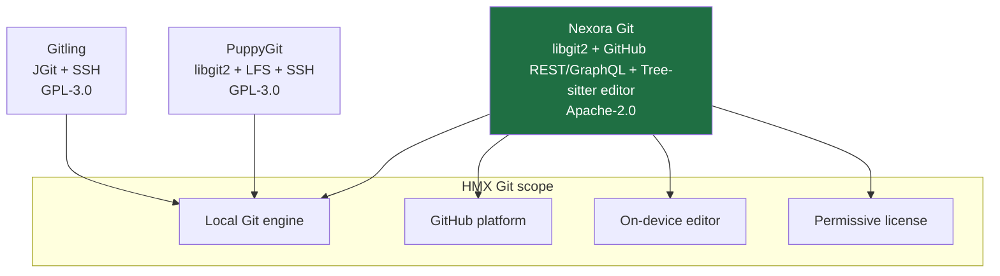

# 17 — Final Decision

**Decision record · HMX Git foundation selection**
**Audit date:** 2026-11-19
**Status:** Final (conditional)
**Supersedes:** none
**Companion documents:** [`13_FINAL_REPOSITORY_RANKING.md`](13_FINAL_REPOSITORY_RANKING.md),
[`14_HMX_GIT_ADOPTION_AND_ENHANCEMENT_ROADMAP.md`](14_HMX_GIT_ADOPTION_AND_ENHANCEMENT_ROADMAP.md),
[`16_AUDIT_LIMITATIONS_AND_UNVERIFIED_CLAIMS.md`](16_AUDIT_LIMITATIONS_AND_UNVERIFIED_CLAIMS.md)

---

## 1. The decision

> ### **Option A — Fork Nexora Git (Apache-2.0).**
>
> **Condition:** adoption is gated on a mandatory **Phase-0 verification** (reproducible build +
> on-device smoke test + signed-release dry run). If Phase 0 fails, switch to **Option E**.
>
> **Baseline commit:** `f4befb6c1954d956f0a67b14f4ab1642aa185833` (`main`, 2026-10-09).

This is a decision about **which codebase to start from**, not a claim that Nexora Git is
production-ready. It is not: it has **zero releases**, **one contributor**, and its own maintainer
has filed issue #57 titled **"release NO-GO."**

---

## 2. Option set and verdicts

| Option | Description | Verdict | Deciding evidence |
| --- | --- | --- | --- |
| **A** | **Fork Nexora Git** (Apache-2.0) | ✅ **SELECTED (conditional)** | Only candidate with Git engine + GitHub platform + editor + permissive license |
| B | Fork Gitling (GPL-3.0) | ❌ Rejected as base | No GitHub platform, no editor, GPL-3.0, 5 tests (reports 04, 11) |
| C | Fork PuppyGit (GPL-3.0) | ❌ Rejected as base | No GitHub API at all, GPL-3.0, 385 KB god object, no tests (report 05) |
| D | Combine code from multiple candidates | ❌ Not selected | Any GPL-3.0 source forces HMX Git to GPL-3.0; permissive-only combination collapses into E (report 10) |
| E | Build independently on selected permissive libraries | 🟡 **FALLBACK** | Feasible (libgit2 + Compose + OkHttp + Room), but re-implements what A already contains |
| F | Do not build / defer | ❌ Rejected | A viable, permissively licensed foundation exists; deferral is not justified |

**Option D note:** "combine" is technically legal only in one direction. Apache-2.0 code may enter a
GPL-3.0 work. GPL-3.0 code may **not** enter an Apache-2.0-only work. Taking Gitling's SSH layer or
PuppyGit's LFS layer into HMX Git therefore converts the whole product to GPL-3.0 — a business
decision the audit does not recommend taking by accident.

**Option F note:** this option is included for completeness. It would be correct only if no
permissively licensed candidate had an engine, a GitHub layer, or an editor. Nexora has all three.

---

## 3. Why Option A — the four decisive facts

### 3.1 It is the only candidate that covers both halves of the product

Every other candidate satisfies **one** half. Nexora satisfies **all four**.

### 3.2 The weighted scorecard favours it under every scope-relevant weighting

| Rank | Repository | Weighted score (0–10) | Where it wins | Where it loses |
| --- | --- | --- | --- | --- |
| **1** | **Nexora Git** | **7.00** | Git engine breadth (7.5), GitHub (8.5), license (10.0), testing (7.5) | Maintenance (3.0), release maturity (1.0) |
| 2 | PuppyGit | 5.23 | Git engine (9.0), performance (7.0) | GitHub (0.5), architecture (4.0), license (3.0) |
| 3 | Gitling | 4.59 | Maintenance (8.5), release maturity (9.5) | GitHub (1.5), editor (1.5), testing (2.0), license (3.0) |

Weights: Git engine 20% · GitHub 12% · Security 12% · Architecture 10% · Android 10% · Testing
10% · Editor 8% · Performance 6% · Maintenance 5% · License 4% · Release 3%.

Sensitivity (report 13 §5): removing the GitHub weight entirely still leaves Nexora first on engine
breadth and tests. Only a **maturity-first** reweighting (Maintenance 25%, Release 15%) makes Gitling
win — i.e. only if the product requirement were "stable pure Git client" rather than "advanced Git
and GitHub workspace."

### 3.3 The license chain is clean

| Component | License | Obligation for a proprietary HMX Git |
| --- | --- | --- |
| Nexora Git source | Apache-2.0 | Retain `NOTICE`, mark modified files, no implied endorsement |
| libgit2 1.9.7 | GPL-2.0 **with linking exception** | Link as-is; ship `COPYING`; do not modify the library |
| Mbed TLS | Apache-2.0 OR GPL-2.0 | Elect Apache-2.0 |
| Tree-sitter + 7 grammars | MIT | Attribution |
| AndroidX / Compose / Hilt / OkHttp / Room / WorkManager | Apache-2.0 | Attribution |

No copyleft propagation. Gitling and PuppyGit would both force GPL-3.0.

### 3.4 The gaps are known, bounded, and fixable behind existing seams

The `GitEngine` interface (48 functions) and `GitCredentialProvider` are already the right
abstraction points. Adding SSH, progress, cancellation and a repository lock does **not** require
rewriting the UI, the GitHub layer or the editor.

---

## 4. What is reused, replaced and built

Full inventory: [`14_HMX_GIT_ADOPTION_AND_ENHANCEMENT_ROADMAP.md`](14_HMX_GIT_ADOPTION_AND_ENHANCEMENT_ROADMAP.md) §2–4.

### 4.1 Reuse as-is (high confidence)

| Area | Key paths |
| --- | --- |
| Git engine + JNI | `core/git/*`, `native/git/src/git_core.cpp`, `advanced_git.cpp`, `git_jni.cpp`, `lfs_filter.cpp` |
| GitHub platform | `core/platform/*` (REST, GraphQL, ETag, pagination, rate limit, error mapping) |
| Feature gateways | `core/issues`, `core/pulls`, `core/releases`, `core/actions`, `core/social`, `core/advanced` |
| Auth crypto | `core/auth/KeystoreCipher.kt` (AES-GCM), `SecureAuthStorage.kt`, PKCE/state validators |
| Editor core | `core/editor/*` (text ops, history, formatter), `native/git/src/syntax_engine.cpp` |
| Storage | `core/storage/*` (SAF strategy, path policy, risk detector), Room, WorkManager |
| Quality | `.github/workflows/*`, `scripts/ci/*`, `app/src/test/**`, `native/git/tests/native_smoke.cpp` |

### 4.2 Replace (blocking before public release)

| # | Gap | Replacement | Evidence it is needed |
| --- | --- | --- | --- |
| R1 | **No SSH** (`USE_SSH OFF`) | libssh2 (`USE_SSH=libssh2`) + key import/generate + `known_hosts` | `native/git/CMakeLists.txt:120` |
| R2 | Credentials only for `https://github.com` | Per-remote allow-list + PAT + SSH key selection | `git_core.cpp:127,139`; `GitRemoteSecurityPolicy` |
| R3 | Self-hosted Go auth broker | **GitHub Device Flow** (default) or an operated broker | `auth-broker/main.go`; issue #57 |
| R4 | No transfer progress | `git_transfer_progress_cb` → UI | absence in `native/git/src/*.cpp` |
| R5 | No cancellation | `git_remote_stop` + coroutine cancellation | absence in native bridge |
| R6 | No repository write lock | `Mutex` keyed by canonical path around every engine call | 8 concurrent `viewModelScope.launch` in `GitWorkspaceViewModel` |
| R7 | Conflict resolution ours/theirs only | three-way / hunk merge UI | `git_core.cpp:2516 resolve_conflict` |
| R8 | No editor tabs/autosave/recovery | `OpenDocument` model + debounced atomic save + journal | `MobileEditorViewModel.kt`; `EditorFileStore.MAX_EDITOR_BYTES` |
| R9 | LSP is a facade | Implement a client, or remove the claim | `LanguageServerClient.kt:5`, zero implementers |
| R10 | No terminal | PTY sandbox (evaluate Termux-style library) | absent in all candidates |
| R11 | Single `:app` module | Split `:core:*` / `:feature:*`; break up 100 KB screen | `settings.gradle.kts` |
| R12 | Release pipeline never executed | Prove `release.yml` end-to-end | 0 tags, 0 releases |

### 4.3 Build new (differentiators preserved from the audit)

Shallow/partial clone · commit-graph lanes (clean-room, not GPL copy) · multi-account switching UX ·
secondary-rate-limit handling · Actions re-run/cancel · PR review submission · notification inbox ·
storage quota & failed-clone cleanup · accessibility · tablet/foldable layouts.

---

## 5. Licensing position

| Question | Answer |
| --- | --- |
| Can HMX Git be closed-source? | **Yes**, if only Apache-2.0/MIT/BSD/EDL components are used |
| Must the `NOTICE` file be kept? | **Yes** — retain upstream attribution and add HMX Git's |
| Must modified files be marked? | **Yes** — Apache-2.0 §4(b) |
| Can Gitling/PuppyGit code be copied? | **Only if HMX Git adopts GPL-3.0.** Use as *reference*, never copy-paste |
| Is Sora Editor usable? | Only with LGPL-2.1 compliance (separate replaceable module, publish modifications); legal review required |
| Trademarks | New name, icon, OAuth app; no implied affiliation with Nexora or GitHub |

This is a technical review, not legal advice. Counsel must confirm before distribution.

---

## 6. Risks and mitigations

| ID | Risk | Level | Mitigation |
| --- | --- | --- | --- |
| FD-01 | Phase-0 build fails (NDK/native/secret injection) | **HIGH** | Time-boxed gate in week 1–2; fall back to E immediately |
| FD-02 | Single contributor abandons upstream | **HIGH** | Vendor the fork; own all code; no dependency on upstream releases |
| FD-03 | No release/device evidence means unknown runtime defects | **CRITICAL** | Device smoke matrix (API 26/29/33/36) before any beta |
| FD-04 | SSH integration destabilises the engine | **HIGH** | libssh2 behind `GitCredentialProvider`; extend `native_smoke.cpp` |
| FD-05 | Concurrent operations corrupt `.git/index` | **HIGH** | Repository mutex + 1,000-iteration concurrency stress test |
| FD-06 | Auth broker operational cost/outage | **HIGH** | Default to Device Flow; broker only if GitHub App features are mandatory |
| FD-07 | GPL contamination by copy-paste | **HIGH** | Provenance rule: no Gitling/PuppyGit code; review every borrowed snippet |
| FD-08 | Large-repo OOM / frozen UI on 3–4 GB devices | **HIGH** | Progress, cancel, shallow clone, streaming editor, benchmarks |
| FD-09 | LSP claim becomes a credibility problem | **MEDIUM** | Implement or remove before any marketing |
| FD-10 | Play policy issues with terminal/PTY | **MEDIUM** | Policy review before building the terminal |

---

## 7. Mandatory Phase-0 gate (blocking)

All six must pass. **Any failure in 1–4 ⇒ switch to Option E.**

| # | Criterion | Command / check |
| --- | --- | --- |
| 1 | Clean Android build | `./gradlew :app:assembleDebug :app:testDebugUnitTest :app:lintDebug` |
| 2 | Native build + tests for all ABIs | `cmake --build` + `ctest` for arm64-v8a, armeabi-v7a, x86_64 |
| 3 | Native integration test | `native_smoke.cpp` against a real bare remote |
| 4 | Device smoke test | Install on API 26 and API 33; init/commit/branch/clone |
| 5 | Signed-release dry run | Reproduce `release.yml` semantics; installable APK |
| 6 | License/NOTICE review | Complete attribution inventory |

**Required toolchain (verified from source):**

| Requirement | Value |
| --- | --- |
| JDK | 17 |
| Android SDK | compileSdk 37, targetSdk 36, minSdk 26 |
| NDK | `27.2.12479018` |
| CMake | ≥ 3.22.1 |
| Gradle | 9.6.0 (wrapper, SHA-256 pinned) |
| AGP / Kotlin | 9.4.0 / 2.2.10 |
| ABIs | `arm64-v8a`, `armeabi-v7a`, `x86_64` |
| Build env vars | `NEXORA_GITHUB_CLIENT_ID`, `NEXORA_AUTH_BROKER_BASE_URL`, `NEXORA_GITHUB_CALLBACK_URL` |

**Explicit disclosure:** none of these builds was executed during this audit — the audit environment
had no Android SDK/NDK and no JDK 21. Phase 0 exists precisely to convert static evidence into
reproduced behaviour. See [`16_AUDIT_LIMITATIONS_AND_UNVERIFIED_CLAIMS.md`](16_AUDIT_LIMITATIONS_AND_UNVERIFIED_CLAIMS.md).

---

## 8. Ownership and maintenance model

| Question | Decision |
| --- | --- |
| Who owns the fork? | HMX Git team — upstream is a starting point, not a dependency |
| Upstream sync policy | Vendor snapshot at `f4befb6`; cherry-pick only security fixes; no automatic merge |
| Bus factor | Must reach ≥ 2 engineers able to build the native layer before beta |
| Release cadence | Internal signed builds from Phase 1; public release only after Phase 7 |
| Security response | Treat native engine CVEs (libgit2, libssh2, Mbed TLS) as P0; pins are commit SHAs, so upgrades are deliberate |
| Documentation | Keep the audited evidence index as the provenance record |

---

## 9. What would change this decision

| Trigger | Consequence |
| --- | --- |
| Phase-0 build or device smoke test fails | **Switch to Option E** (independent build) |
| Nexora upstream relicensed or abandoned > 90 days with no viable fork | Re-evaluate E; the vendored snapshot still permits A |
| A CRITICAL security defect in the native engine is found and unfixable | Re-evaluate JGit (Option E variant) despite its Android issues |
| HMX Git decides to be GPL-3.0 | Option B/C become viable; re-run the scorecard with equal license weights |
| A new permissively licensed candidate appears with SSH + GitHub + editor | Re-run discovery before committing Phase 2 effort |
| Team refuses to own an NDK toolchain | Option E on JGit, accepting the Java-17 bytecode workaround |

---

## 10. Conditional recommendations to the product owner

1. **Approve Option A now, but authorize no public commitment until Phase 0 passes.**
2. **Budget the known build-out:** ~6–8 months with a small experienced team (report 14 §9), with
   engine hardening (SSH/progress/cancel/lock) as the critical path.
3. **Make Device Flow the default auth** to remove the broker from the critical path.
4. **Do not market LSP, terminal, or SSH** until each is implemented and device-tested.
5. **Keep the audit evidence index** as the provenance record for licensing and for future
   re-audits.

---

## 11. Decision summary

| Item | Value |
| --- | --- |
| **Final recommendation** | **Option A — Fork Nexora Git** |
| Base license | Apache-2.0 |
| Base commit | `f4befb6c1954d956f0a67b14f4ab1642aa185833` |
| Engine | libgit2 1.9.7 via 50-function C++ JNI (add libssh2) |
| GitHub layer | REST + GraphQL + ETag + rate limits (reuse) |
| Editor | Compose + native Tree-sitter (reuse; add tabs/autosave) |
| Auth | Device Flow (default) or operated broker |
| Weighted score | 7.00 / 10 (rank 1 of 3) |
| Gate | Phase 0 — build + native tests + device smoke + signed dry run |
| Fallback | Option E — independent composition |
| Confidence | **High** in the ranking; **Medium** in runtime behaviour until Phase 0 completes |

---

**Conclusion.** Nexora Git is the strongest available foundation for HMX Git and the only one that
supports the full product scope under a permissive license. It is not shippable today. Proceeding
with Option A is justified **only** because the audit has identified exactly what is missing, where
it lives, and how to verify the base before committing significant engineering effort.

*End of audit set.*
